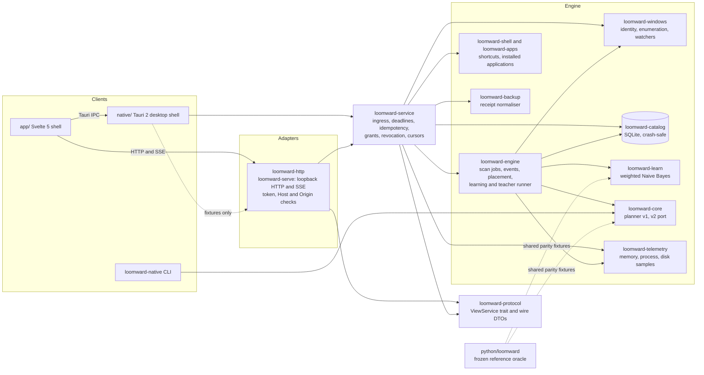

# Loomward

<p align="center"></p>

Loomward is a local-first Windows workspace memory that keeps what your files mean apart from where they live and what is allowed to act on them.

[](https://github.com/Chris0Jeky/Loomward/actions/workflows/ci.yml)
[](LICENSE)
[](https://github.com/Chris0Jeky/Loomward/releases)
[](pyproject.toml)
[](Cargo.toml)

**Your files, understood. Nothing touched without you.** It is a research prototype. It reads and simulates. It does not move, delete, rename, kill or reprioritise anything on your machine, and the two narrow file writes it has are listed under [No file or process effects](#no-file-or-process-effects).

## What it is and why it exists

Most disk tools answer one question: how much space is used, and where. Loomward splits a file into three facts that tools tend to blur:

- **Meaning**: what the file is part of. A project, finance, a collection.
- **Residency**: where the bytes live. C:, G:, E:, online-only, or unknown.
- **Permission**: whether anything may act on it. Pinned, protected, granted by you.

These are separate systems on purpose. A file can belong to a project and to Finance without moving. A disk policy can keep the active project on the fast volume without changing what the project contains. A learned score is never an approval. Disk size, duplicates, backups, processes and storage tiers are views over that model. They are not the pitch.

The rules that follow from this are enforced by the code and its tests, not by good intentions:

- **Unknown stays unknown.** Partial, offline or unverified data is shown as such. Telemetry reports `null` with a reason, never zero. Before any labels exist, the learner reports that it has no model rather than guessing.
- **Evidence has blanks.** A green backup job is never shown as verified recovery. Restore drills are not built, so the Backups view says so.
- **Agents get a read-only view.** The MCP reference exposes four read-only tools over a supplied snapshot (`workspace_summary`, `catalog_search`, `evidence_explain`, `placement_simulate`). Names are off by default, so only `workspace_summary` and `placement_simulate` are advertised unless disclosure is enabled. There is no execute, delete, move or kill tool, through HTTP, IPC or MCP.

### The three threads

The "Woven atlas" interface draws the three facts as cloth threads:

| Thread | Question | In the atlas |
|---|---|---|
| **Meaning** | What is this part of? (collection, project, label) | Warp: vertical threads dyed by collection |
| **Residency** | Where does it live? (tier: C:, G:, E:) | Weft: metal threads; hollow means online-only; missing means unknown |
| **Permission** | May anything act on it? (pinned, protected) | Selvedge: stitched edge where a hold begins |

A collection can list every file of a project without moving one. A disk policy can keep the active project on the fast disk without changing what the project contains. A learned score is never an approval.

Whether learned organisation beats folders is an open question, not a result. [docs/44](docs/44-product-thesis.md) states the thesis, the first five minutes and what would falsify it. [docs/24](docs/24-thesis-and-research-program.md) describes how it would be tested.

## Status

Research prototype. Not a file manager, not a system optimiser, not a backup tool. The Python reference is a frozen test oracle. The product is the Rust engine and the Svelte app.

| Piece | State | Read more |
|---|---|---|
| Python reference (`python/loomward/`) | Frozen since owner decision q-40 (2026-10-12). Synthetic demo, bounded metadata scan of one explicit folder, a small student model, a tier simulator, and a read-only MCP reference. Its legacy browser UI is retired. | [docs/30](docs/30-interface-and-workspace-spec.md#legacy-browser-ui-retired) |
| Rust engine (`crates/`) | First compiled and tested on Windows 11 on 2026-10-09. [docs/16](docs/16-implementation-status.md) last recorded Windows counts at wave 8 (`b00c564`): 917 Rust tests. On 2026-10-12, `python3 scripts/verify.py` passed on Linux (Python 3.12.3, rustc 1.99.0): 243 Python tests (8 skipped), rustfmt, workspace tests and clippy. Counts move with every merge; the command output is the authority. Windows-only paths run only on Windows. | [Architecture](#architecture) |
| Svelte app (`app/`) | Thirteen views, discovered from `app/src/views/*/View.svelte`: Explorer, Collections, Duplicates, Atlas, Observatory, Tiers, Learning review, Applications, Desktop, Companion, Backups, Grants & health, Updates. Mock transport, HTTP to `loomward-serve`, or Tauri IPC. With no engine it shows "unavailable", not demo data. | [app/src/views](app/src/views) |
| Desktop shell (`native/`) | Tauri 2 on WebView2, with a strict CSP and a headless `--self-test`. Hosted CI builds it, tests it and runs the self-test on `windows-latest`. | [native/README.md](native/README.md) |
| Preview release | `0.3.0-preview.1` is an unsigned Windows pre-release on the [Releases page](https://github.com/Chris0Jeky/Loomward/releases). It is built by the release workflow. | [RELEASING.md](RELEASING.md) |
| Nightly channel | The rolling nightly workflow is merged (#432). It publishes only after a green CI run on `main`. | [RELEASING.md](RELEASING.md#nightly) |

## Features

What is built, with the caveats that matter. Anything not in this table is not built.

| Capability | State | Notes |
|---|---|---|
| Metadata scan of granted folders | Built. Personal scans are open. | Explicit roots only, chosen through the Windows folder picker or `--grant-root`. A volume root is allowed only from the native picker, never from `--grant-root`. Non-elevated, metadata only (names, sizes, times, identity). It refuses whole profiles, AppData, credential and browser stores, network and removable drives, links, cloud placeholders and any folder that holds Loomward's own state. FAT and exFAT are listed as identity-unverified. |
| Duplicate inspection | Built. Personal content reads are open (q-10). | Byte-equality groups from catalogue candidates. Reads are budgeted, paged and read-only. Nothing is removed. |
| Collections | Built. | Virtual groups. Members are listed without moving a file. |
| Learning | Built locally on your own labels (q-11). The teacher stays synthetic-only. | Weighted multinomial Naive Bayes with explicit abstention. Human labels weigh 1.0, teacher labels 0.2, and the two stay separate. Scores are relative, not probabilities. |
| Meaning threads (Atlas) | Built. | Shows what the student suggests and marks it as a suggestion, never an approval. |
| Tier simulation | Built, simulation only. | Greedy simulator in Python (v1 and v2) and a Rust port. Nothing is moved. |
| Backups | Stage 1 only. | Imports restic receipts through a native open dialog. A green job is never shown as verified recovery. |
| Applications and desktop | Read-only. | Installed-application registry inventory and known folders. Personal shortcut enumeration is unavailable by design. |
| Process and memory (Companion, Observatory) | Windows only. Read-only. | Bounded process list with coverage. Unknown values carry reasons. Budgets are read-only, and there are no end, pause or priority controls. |
| Resource trends | Built. | Growth and contention candidates that cite their facts. They are not verdicts. |
| Diagnostic bundle | Desktop only. | Previewed, redacted and typed. Saved only to a file you pick in a native save dialog. |
| Forget a revoked root | Built. | Deletes Loomward's own records of a root you revoked, never your files. |
| Accessibility | Checked. | The Playwright suite has a `--a11y` leg for names, focus, announcements, zoom reflow and contrast. |
| Find and Ask (search index, chat over read-only tools) | Planned. Not built. | [docs/46](docs/46-find-and-ask.md) |
| Copy-and-verify (first file effect) | Planned. Not built. | Behind its own safety gate ([LW-124](backlog/issues/LW-124.md)). |

## Architecture

The engine is a set of Rust crates behind one typed service. Every client calls the same `ViewService`, either over loopback HTTP and server-sent events or in-process in the desktop shell. The Python reference shares parity fixtures with the Rust code and is not on the product path.



| Path | What it is |
|---|---|
| `crates/loomward-protocol` | The view-service contract: envelopes, commands, events, DTOs, and the `ViewService` trait. The wire contract is in [`contracts/v3/`](contracts/v3/). |
| `crates/loomward-service` | The typed service both adapters call. It owns ingress, deadlines, idempotency, node IDs, cursors, provenance, grants and revocation. |
| `crates/loomward-http` | `loomward-serve`, the loopback HTTP and SSE adapter and the browser's security boundary. `--fixtures` serves the contract examples with no state and no scanning. |
| `crates/loomward-engine` | Scan jobs and their cancellation, events, the scan pipeline with identity dedupe and honest partials, placement simulation, and the learning and teacher runners. Change-tracked reconciliation exists here and is not yet reachable from the app. |
| `crates/loomward-windows` | Read-only Windows identity and volume observation, non-elevated enumeration, and `ReadDirectoryChangesW` watchers. An opt-in `fixtures` feature builds a disposable lab. |
| `crates/loomward-catalog` | The durable SQLite catalogue, with crash-safe reference retirement. Its crash sweeps are in `tests/`. |
| `crates/loomward-core` | Pure domain code: the capability policy, the simulated transaction state machine, planner v1 and a Rust port of planner v2. |
| `crates/loomward-learn` | Rust port of the weighted Naive Bayes student. Python is the oracle; 288 parity cases live in [`fixtures/learning-v3/`](fixtures/learning-v3/). |
| `crates/loomward-telemetry` | Read-only memory, process, PDH disk and GPU-adapter sampling on Windows. Per-process GPU is unsupported. Non-Windows builds report unsupported. See its [README](crates/loomward-telemetry/README.md). |
| `crates/loomward-apps`, `loomward-shell` | Read-only installed-application inventory and shortcut reading. |
| `crates/loomward-backup` | Pure, bounded backup-receipt normalisation. No provider execution. |
| `crates/loomward-lab` | Synthetic scale trees, four enumeration strategies, and benchmarks. Windows only. See its [README](crates/loomward-lab/README.md). |
| `crates/loomward-cli` | The `loomward-native` source CLI: `capabilities`, `scan ROOT [MAX_ENTRIES]`, `plan SCENARIO.json`. |
| `app/` | Svelte 5, Vite and TypeScript. `app/prototype/` is the no-build woven-atlas and Observatory prototype. |
| `native/` | Tauri 2 desktop shell. Excluded from the root workspace and built with its own `Cargo.lock`. |
| `python/loomward/`, `scripts/` | The frozen Python reference: scanner, student, tier simulator, loopback API, CLI and MCP reference. |
| `contracts/`, `schemas/`, `fixtures/` | Wire contracts, interchange schemas, and synthetic fixtures with parity corpora. |
| `docs/`, `backlog/`, `evidence/`, `handoff/` | Design documents ([index](docs/INDEX.md)), the `LW-*` backlog, recorded measurements, and history from the original authoring pass. |

## Quickstart

Run these from the repository root. Commands were checked on Linux (Ubuntu, Python 3.12, Rust 1.99, Node 22) on 2026-10-12 unless marked otherwise. On Windows, use `py -3` for `python3` and `npm.cmd` for `npm`.

### Python reference (no dependencies)

```bash
python3 scripts/run.py doctor
python3 scripts/run.py demo --state-dir /tmp/loomward-demo
```

`doctor` prints the capability flags and the tools it can see. `demo` starts a loopback-only JSON API on port 8765 over synthetic data. It serves no pages. It prints a URL with a `#token=` fragment, which is the session secret, so keep it private. Use `--port 0` for a free port. Ctrl+C stops it. Scanning a real folder is a separate step, `scripts/run.py serve --root <folder>`. Read the [operating guide](docs/38-reference-operating-guide.md) first.

```bash
PYTHONPATH=python python3 -m unittest discover -s tests
```

Result on Linux (2026-10-12, Python 3.12.3): 243 tests, 8 skipped. The skips come from the optional `jsonschema` validator and from tests that need links or privileges this machine lacks.

### Rust workspace

Needs Rust 1.85 or later, as the workspace's `rust-version` says. The desktop shell needs 1.89.

```bash
cargo test --workspace
cargo clippy --workspace --all-targets -- -D warnings
cargo fmt --all -- --check
cargo run -q -p loomward-cli -- capabilities
cargo run -q -p loomward-cli -- scan ./docs 1000
```

The `scan` command reads metadata only, under an explicit root and an entry limit.

### Svelte app

Hosted CI uses Node 24.

```bash
npm --prefix app ci
npm --prefix app run dev
```

Open the address Vite prints and add `?transport=mock`. The mock answers from invented, contract-shaped data, including the catalogue and resource figures. Anything the mock does not supply stays explicitly unknown. These are not engine observations. Without `?transport=mock` and without an engine, the shell shows "unavailable" by design (`app/src/lib/transport/select.ts`).

Full app checks, in the order CI runs them:

```bash
npm --prefix app run check
npm --prefix app run test
npm --prefix app run build
python3 -m pip install playwright && python3 -m playwright install chromium
python3 scripts/test_app.py
```

`scripts/test_app.py` needs `app/dist`, so build first. It runs the browser checks on Linux. Hosted CI runs this suite on Ubuntu only.

### The engine over loopback

```bash
npm --prefix app run build
cargo run -p loomward-http --bin loomward-serve -- --state-dir .loomward/dev-state --dataset synthetic --static app/dist
```

This starts the engine's synthetic session on loopback and serves the built app from it. It prints a URL with a `#token=` fragment. The synthetic session scans only registered lab roots, so it has nothing to scan until a lab root is registered. To see the contract examples without any state, use `--fixtures` instead of `--state-dir`. Do not run `loomward-serve` as administrator or bind it beyond loopback.

### Telemetry

```bash
cargo run -q -p loomward-telemetry -- snapshot --json
```

One compact JSON object. Unknown values are `null` with a reason, never zero. On Linux the status is `unsupported`, because native telemetry is Windows-only. The rate and disk-throughput fields are unknown on the first sample. Schema: [crate README](crates/loomward-telemetry/README.md).

### Windows only: the desktop shell

Not run here, because it needs Windows. These are the commands hosted CI runs, plus the local run.

```powershell
npm.cmd --prefix app ci
npm.cmd --prefix app run build
cargo build --manifest-path native/Cargo.toml
native\target\debug\loomward-desktop.exe --dataset synthetic --state-dir .loomward\desktop-state
native\target\debug\loomward-desktop.exe --self-test
```

Run with no arguments, the desktop opens the personal session on your real state directory, and no folder is scanned until you pick one. Agents and scripts should use `--dataset synthetic` or `--fixtures` with a scratch `--state-dir`, as the self-test does. Read [native/README.md](native/README.md) first.

### Windows only: the scale lab and the enumeration bench

The lab writes to disk, so read [its README](crates/loomward-lab/README.md) before running anything. Roots must be direct children of `G:\loomward-lab\scale` or `E:\loomward-lab\scale`.

```powershell
cargo build -p loomward-lab --release --offline
target\release\loomward-lab.exe generate --root G:\loomward-lab\scale\example --files 100000 --seed 42 --profile mixed --threads 8
target\release\loomward-lab.exe bench --root G:\loomward-lab\scale\example --strategy handle --threads 8 --buffer-kib 64 --cache-label uncontrolled
```

The generator never overwrites an existing root, reserves 20 GB (decimal) of free space, and stops at 3M files. The 10M-entry tier is planned for `E:` only (ADR-V3-17). `cross-check` runs the four strategies against an explicit real folder and refuses volume roots and profile or credential locations.

### Prototype

```bash
python3 -m http.server -d app/prototype 8040
```

Open `http://127.0.0.1:8040/` from the repository root. Opening `index.html` from disk does not work, because browsers refuse ES modules over `file://`.

## Verify

Run from the repository root. Missing tooling is reported as UNVERIFIED, never as a pass.

| You changed | Run |
|---|---|
| Python reference (frozen oracle), schemas, fixtures | `python3 scripts/verify.py` (also runs the Rust gates when `cargo` is present) |
| Rust workspace | `cargo fmt --all --check`, `cargo test --workspace`, `cargo clippy --workspace --all-targets -- -D warnings`; add `--all-features` for the Windows fixture lab |
| Svelte app | `npm --prefix app run check`, `... run test`, `... run build`, then `python3 scripts/test_app.py` |
| Everything | `python3 scripts/verify.py --app`. It reports UNVERIFIED when Node, npm, `app/node_modules` or Playwright is missing, and an explicit `--app` request then exits 2 ([#431](https://github.com/Chris0Jeky/Loomward/issues/431)). |
| Desktop shell (Windows) | `cargo test --manifest-path native/Cargo.toml`, then `native/target/debug/loomward-desktop.exe --self-test` |
| Prototype | `python3 app/prototype/check.py`. It rewrites the screenshots under `evidence/v3/ui-prototype/`. Revert them with `git checkout --` unless you mean to update them. |
| Docs only | `git diff --check` plus the links you touched |

Hosted CI is [`.github/workflows/ci.yml`](.github/workflows/ci.yml), with four jobs:

- `python`: unit tests on Python 3.11 and 3.13, on Ubuntu and Windows.
- `native`: rustfmt, the workspace tests and clippy, on Ubuntu and Windows.
- `desktop`: builds the desktop shell and runs its tests, clippy and `--self-test`, on Windows.
- `app`: `check`, `test` and `build` on Ubuntu and Windows. The Playwright suite runs on Ubuntu only.

Local runs are not hosted CI, and this README says so wherever it matters. The counts move with every merge. The command output is the authority.

## Measured results

Every figure below is a first measurement on one Windows 11 machine, non-elevated. Each is a starting point, not a guarantee. The receipts are in `evidence/`.

**Native enumeration spike** ([docs/research/enumeration-spike.md](docs/research/enumeration-spike.md), raw receipt [`evidence/v3/enumeration-spike.json`](evidence/v3/enumeration-spike.json)). Four ways of walking synthetic trees on a fast local NTFS volume, wall time:

| Strategy | 100,000 files | 3,000,000 files |
|---|---:|---:|
| `std::fs::read_dir`, one worker | 7.91 s | 226.67 s |
| same, 8 threads | 1.05 s | 42.76 s |
| `FindFirstFileExW`, 8 threads | 0.054 s | 1.07 s |
| `GetFileInformationByHandleEx`, 8 threads | 0.036 s | 0.64 s (4.7 M files/s) |
| Python reference scanner | 10.90 s | not measured |

All 43 final and tuning runs matched the generated manifest exactly. The best static candidate was the handle strategy with eight workers and 16 KiB buffers, at 5.38 M files/s (median of paired runs at 3M). Caveats that matter: **caches were uncontrolled (warm)**, with no cold-cache result, reboot or purge, and antivirus was not isolated. The files are synthetic, sparse and zero-filled, and no database was written, so this says nothing about catalogue speed. The native walkers only add up totals, while the Python scanner builds per-file records. WinDirStat was not run.

**Real folders** ([report](docs/research/real-folder-stress.md), [receipt](evidence/v3/real-folder-stress.json)). Four owner-authorised folders, named `real-A` to `real-D`, walked read-only with metadata only. A and B and C are on the fast local volume, D on the slow local volume. Warm median wall time over five runs:

| Root | Entries | Logical GiB | `handle` | `find` | `std-single` |
|---|---:|---:|---:|---:|---:|
| real-A | 323,788 | 68.23 | 0.404 s | 0.593 s | 14.44 s |
| real-B | 311,449 | 79.66 | 0.680 s | 0.954 s | 15.02 s |
| real-C | 200,575 | 16.60 | 0.930 s | 1.179 s | 12.22 s |
| real-D | 14,824 | 20.49 | 0.033 s | 0.035 s | 0.287 s |

The four strategies agreed exactly on 23 of 24 final-build sweeps. The exception was a live folder (real-A) that grew by 894 bytes between two walks. The report keeps that as a failed comparison, not a pass. Skipped links and denied directories stay counted. There is no true cold-cache run.

**Catalogue.** The P4 insert bench measured a median of 95,916 rows/s on `main` and 109,388 rows/s on the later branch, on a shared host ([crates/loomward-catalog/HANDOFF.md](crates/loomward-catalog/HANDOFF.md)). The P4 target is 250k rows/s and is not met ([#148](https://github.com/Chris0Jeky/Loomward/issues/148)).

**Allocator.** `loomward-core` carries a Rust port of the v2 allocator. A 222-case parity corpus matches Python on all 193 accepted cases field for field, and Rust rejects all 29 inputs that Python rejects ([evidence/v3/planner-v2-rust.md](evidence/v3/planner-v2-rust.md)). On the original 51 synthetic scenarios, v2 misses no feasible target and v1 misses 9. This is a static model. Nothing is moved. v1 and its counterexample are kept ([docs/22](docs/22-experiment-findings.md)). The engine calls planner v2 from placement simulation (`placement.simulate`); it does not move files.

**Student.** The Rust student is checked against 288 parity cases (230 tokeniser, 58 student scenarios) in [`fixtures/learning-v3/`](fixtures/learning-v3/), with Python as the oracle. Run `cargo test -p loomward-learn`. Scores are uncalibrated.

**Telemetry.** On one Windows 11 host, a standalone snapshot took 655.92 ms, including first-call set-up. Three-sample watch intervals took 445.37, 36.83 and 28.41 ms. Host values are omitted from the public receipt ([evidence/v3/telemetry.md](evidence/v3/telemetry.md)). This is a small run, not an overhead guarantee.

**Teacher spike** ([docs/research/teacher-confinement.md](docs/research/teacher-confinement.md)). Synthetic data only. A hardened Codex CLI invocation returned valid output on 10 of 10 batches of 25 items (median 21.8 s) and disclosed no canary. A collaboration tool stayed callable despite its flags. Verdict: partially confinable. The teacher stays synthetic-only until an OS-enforced boundary is demonstrated.

**Not yet measured:** true cold caches, WinDirStat, WebView2 end to end on hosted CI, a persistent catalogue at P4 speed. The targets in [docs/41](docs/41-v03-architecture.md) section 15 are hypotheses, not results.

## Tech stack

- **Python 3.11+.** The reference uses the standard library only. Optional extras: `psutil` for process telemetry, `jsonschema` for contract tests, `playwright` for the browser checks.
- **Rust.** A Cargo workspace (`rust-version` 1.85) and a separate desktop shell (1.89). Main dependencies: `rusqlite` with bundled SQLite, `axum` and `hyper` on `tokio` for the loopback server, `serde` and `serde_json`, `sha2`, and `windows-sys` for the Win32 calls (`ReadDirectoryChangesW`, `FindFirstFileExW`, `GetFileInformationByHandleEx`, PDH).
- **Desktop.** Tauri 2 on WebView2, `rfd` for native dialogs, and the Tauri updater plugin with rustls, driven from Rust only and opt-in. The updater answers "not configured" until the owner stores the updater public key (q-30).
- **App.** Svelte 5, Vite 8, TypeScript 5.9, Vitest, `svelte-check`, and Playwright for end-to-end checks. The built page ships with a strict CSP.
- **CI and release.** GitHub Actions with actions pinned to full commit SHAs. The preview and nightly builds use an NSIS installer. Nothing is signed yet.

## Status and roadmap

**Shipped since the 12 October 2026 decisions** (each has its own PR; [docs/16](docs/16-implementation-status.md) is the wave-8 checkpoint and does not yet list these):

- Unsigned preview `0.3.0-preview.1` and the rolling nightly channel (#432). Nightly publishes only after a green CI run on `main`.
- The daily-use readiness checklist ([docs/45](docs/45-daily-use-readiness.md)): nine items, five partial, four unverified. The owner judges "done".
- The Python reference frozen and the legacy browser UI retired (q-40).

**Next, decided but not built:**

- Find and Ask: a search index over granted roots ([LW-113](backlog/issues/LW-113.md)), Everything integration ([LW-114](backlog/issues/LW-114.md)), a semantic layer ([LW-116](backlog/issues/LW-116.md)), and an Ask provider interface with read-only tools ([LW-117](backlog/issues/LW-117.md), [LW-118](backlog/issues/LW-118.md)). Design: [docs/46](docs/46-find-and-ask.md).
- Copy-and-verify as the first file effect, behind its own gate ([LW-124](backlog/issues/LW-124.md)). Until that gate passes, the invariant stays in force: no move, delete or copy of your files.
- Package channels: winget, a Scoop bucket and the Microsoft Store ([LW-126](backlog/issues/LW-126.md), [packaging/README.md](packaging/README.md)). Code signing is a later owner decision.
- An observe-only Linux port, after the Windows bar ([LW-130](backlog/issues/LW-130.md)).

**Not established yet:**

- Copy-and-verify of the owner's files, or any other file or process effect. The two narrow writes that exist (diagnostic save, forget of Loomward's own records) are listed under [No file or process effects](#no-file-or-process-effects).
- Restore drills for backups.
- A real FAT or exFAT volume test, and a real picker grant exercised by a person.
- Quiet-host runs for the bulk-load A/B ([#148](https://github.com/Chris0Jeky/Loomward/issues/148)) and the 10-minute telemetry overhead run ([#160](https://github.com/Chris0Jeky/Loomward/issues/160)).
- Performance of the bulk-load path after the P14 regression ([#386](https://github.com/Chris0Jeky/Loomward/issues/386)).

The backlog is [`backlog/issues.json`](backlog/issues.json), with 130 `LW-*` items. Its `status` field records 7 done, 10 in progress and 113 planned. `LW-*` IDs are not GitHub issue numbers. [`backlog/github-issues.json`](backlog/github-issues.json) maps them.

## Links

- **Docs:** [docs index](docs/INDEX.md), [product thesis](docs/44-product-thesis.md), [architecture](docs/41-v03-architecture.md), [decisions](docs/42-v03-adrs.md), [implementation status](docs/16-implementation-status.md), [operating guide](docs/38-reference-operating-guide.md).
- **Releases:** [Releases page](https://github.com/Chris0Jeky/Loomward/releases) and the [release process](RELEASING.md).
- **Demo:** there is no hosted demo. The mock transport in dev mode is the closest thing, and it shows invented data.
- **Issues:** [GitHub issues](https://github.com/Chris0Jeky/Loomward/issues).
- **Licence:** [LICENSE](LICENSE) (AGPL-3.0-only). See also [CLA.md](CLA.md) and [TRADEMARKS.md](TRADEMARKS.md).

## Architecture and development

- **Agents** read [AGENTS.md](AGENTS.md) first. It is the one baseline for every agent runtime, and it lists the product invariants. Break one and it is a bug.
- **Open owner decisions** are in [HUMAN_TODO.md](HUMAN_TODO.md).
- **Plan:** [docs/41](docs/41-v03-architecture.md) (architecture), [docs/42](docs/42-v03-adrs.md) (decisions), [docs/43](docs/43-v03-lanes.md) (lanes). The status for each wave is at the end of [docs/16](docs/16-implementation-status.md).

## Contributing

Read [CONTRIBUTING.md](CONTRIBUTING.md) first. Start with one backlog issue and a reproducible fixture. Use synthetic data in every committed test and screenshot. Personal paths, real file names, inventories, databases and `.loomward/` state never go into Git. Safety, protocol, privacy, elevation and any new mutation capability need design review first.

Outside contributions need a signed [Contributor Licence Agreement](CLA.md). You keep your copyright. A bot asks for the signature on your first pull request.

## Security

Loomward is an observation-only research prototype. It is not a production file executor or a backup tool. Read [docs/05-safety-security.md](docs/05-safety-security.md) for the trust boundaries and known limitations.

Report security issues privately to the repository owner, not in a public issue. A public reporting address has not been set up yet ([SECURITY.md](SECURITY.md)). Do not run the reference server as administrator or SYSTEM, and do not expose it beyond loopback. Do not point experiments at irreplaceable files, protected OS locations or live application stores. The prototype makes no guarantee against malware running as the same user, or against an administrator who tampers with it.

## Licence

- **Source:** AGPL-3.0-only, since [#396](https://github.com/Chris0Jeky/Loomward/pull/396) (2026-10-12). Earlier versions were MIT.
- **Commercial licences.** Loomward is dual licensed. Besides the AGPL, the maintainer can grant proprietary licences. To ask for one, contact the maintainer through GitHub ([@Chris0Jeky](https://github.com/Chris0Jeky)).
- **Contributions** need a signed [Contributor Licence Agreement](CLA.md). You keep your copyright. Outside code is merged only after its author has signed.
- **The name.** "Loomward" is an unregistered project name. See [TRADEMARKS.md](TRADEMARKS.md).

## Stance

No theatre and no false claims. No release, package or "done" status is declared to show progress. Unknown, partial and unverified stay visible. Failed experiments are kept. Loomward does not claim native compilation of its desktop shell on every platform, backup verification, memory optimisation, learned heat, live disk balancing or safe deletion, because none of them has passed its own gate.

## No file or process effects

Nothing in Loomward moves, deletes, renames, kills, suspends, reprioritises or trims anything on your machine. Two narrow file operations exist, and both are reviewed:

- **Diagnostic bundle (desktop only).** Saves exactly the previewed, redacted bytes to a file you choose in a native save dialog. The path never crosses IPC, and nothing is uploaded.
- **Forget a revoked root.** Deletes Loomward's own records of that root (names, catalogue rows, labels, references, and its state copies). It never touches the files themselves. An anonymised audit entry remains. Traces may remain in unused disk space until it is overwritten.

The lab creates and deletes only its own marked, disposable synthetic trees. The Python reference writes its own state database. Backup, relocation, uninstall and process control are future work behind separate safety gates. The Python reference and the native Rust engine are reported separately, so a Python result is never evidence about the native engine, and the reverse.
