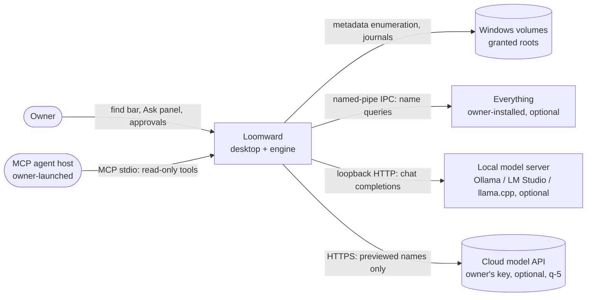
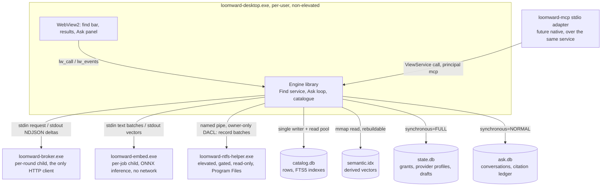

# 46: Find & Ask: search tiers, the semantic layer and the Ask provider interface

Status: **proposed** (2026-10-12), for the driver's acceptance; if accepted it is **ADR-V3-26** in
[42](42-v03-adrs.md). It records owner decisions q-34 (scope), q-35 (where the model runs) and q-36 (search
reach) of 2026-10-12 in `HUMAN_TODO.md`, and designs the pillar they open. q-34's four other areas
(developer clutter, content understanding, cloud and sync awareness, monitoring and alerts) are out of scope
here. Nothing here is built. The search v1 lane (SQLite FTS5 substring and token index behind
`search.query`) is in flight separately, and this document builds on it rather than redesigning it. Contract
shapes (commands, DTOs, the query grammar) belong to the contracts owner; schemas belong to the catalogue
owner. This document says what they must provide, not their exact fields.

It extends [25](25-control-evidence-architecture.md), [27](27-provider-runtime-and-events.md),
[28](28-mcp-specification.md) and [41](41-v03-architecture.md), and reuses the teacher broker
([inference broker ADR](superpowers/specs/2026-10-11-inference-broker-adr.md),
[synthetic broker design](superpowers/specs/2026-10-10-synthetic-inference-broker-design.md)) instead of
inventing a second egress path. It changes no product invariant. One proposed wording change to invariant 2
(section 5.4) is for the driver and lands only with its gate.

## 1. Frame

**What the owner asked for** (q-34 to q-36, core text): "the ability to easily find what is needed", a search
engine "extremely well-optimised and engineered for efficiency and robustness", and "a smaller model with which
one can chat and ask about the files, apps, etc", integrated "seamlessly", usable by humans too, possibly local.
On reach: "The most effective choices possible in terms of performance and capabilities. no matter the
engineering cost". The owner chose: an own index on granted roots as the backbone; an optional elevated NTFS
metadata helper behind its own gate; and Everything (voidtools) integration where installed. Under the
owner's "whatever extra", the driver added a local semantic (embedding) layer (q-36). On the model, the owner
chose one provider interface: a local OpenAI-compatible endpoint first, then cloud with the owner's own key
under q-5's rules, then a bundled engine with consented downloads (q-35). The model gets read-only tools over
the same query surface as people and MCP agents. Anything it proposes doing becomes a proposal the owner
approves.

**Forces.** One owner, many parallel agent lanes. Windows 11 host. Public AGPL-3.0-only repository with dual
licensing (q-20, q-21). Tier T2 with privacy and security weighed lower (q-16), but secrets and real names stay
out of Git. Existing pieces: the `ViewService` trait and 45 effect-free commands
([41 section 5](41-v03-architecture.md)); scan-scoped `ReadDirectoryChangesW` watchers (#183, #202);
unprivileged USN catch-up measured on G: and E: ([change-tracking research](research/change-tracking.md));
a Python MCP reference ([28](28-mcp-specification.md)); the broker design for the teacher (not yet built);
the app inventory (`apps.list`) and read-only telemetry.

**Quality attributes, ranked.**

1. **Correctness and honesty.** A hit is a real catalogue row, or it is labelled by its source and freshness.
   An answer cites the rows it rests on. Unknown, stale and partial stay visible (invariant 4).
2. **Performance.** Interactive find at 1M to 10M entries; a small local model answering in seconds.
3. **Security and disclosure** stays a hard constraint rather than a trade-off axis: no effect surface
   (invariant 1), no silent reach (invariant 2), data classes kept apart (invariant 3), MCP read-only
   (invariant 7). Weighed per q-16.
4. **Maintainability.** One query surface, one provider interface, one egress process.
5. **Operability.** Every tier degrades on its own. A dead model never breaks search.
6. **Cost.** No servers and no paid services unless the owner adds a key.

The two that drive this design are **correctness** and **performance**.

**Hard constraints.** Invariants 1 to 9. No automatic downloads, cloud calls, installs or elevation. Model
output is never an approval. Synthetic and personal evidence never mix. **Preferences.** Rust for everything
in the engine. Reuse the broker. No new long-running daemon unless measurement earns one.

**Assumptions** (each with how to settle it):

- A1. The owner's GPU and RAM for local models are unknown. The section 9 eval measures them on the
  owner's machine and records them with generic labels (q-18).
- A2. Which Everything version, if any, is installed is unknown. 1.5 is still an alpha that runs as the
  named instance `1.5a` [F02]. Settle it with a read-only probe for the 1.5 pipe and the 1.4 IPC window.
- A3. The language mix of the owner's file names is unknown. The semantic bake-off (section 6.2) reports the
  share of non-ASCII names on granted roots as an aggregate.
- A4. Scale: the lab tiers M (1M entries) and L (10M entries) stand in for the owner's roots until a real
  stress folder (q-4) is measured.

## 2. Context (C4 level 1)

Every arrow out of Loomward is opt-in and read-only. The cloud arrow exists only after q-5's conditions hold
(section 8.3).

## 3. Containers (C4 level 2)

| Container | Owns | Must not own |
|---|---|---|
| Engine library (in-process, [41](41-v03-architecture.md) ADR-V3-01) | Find planner, ranking, the Ask loop and tool executor, disclosure projection, citation ledger | Network code, credentials, elevation |
| `loomward-broker.exe` | One validated model call per process (one model round), streaming, endpoint pinning, credential (cloud only) | Tools, files, a second request, conversation state |
| `loomward-embed.exe` | Embedding inference on bounded text batches from a hash-pinned local model file | Network, file reads beyond its model file, catalogue access |
| `loomward-ntfs-helper.exe` | NTFS metadata enumeration and journal reads, filtered to what the owner may list | Contents, writes, network, child processes, grants |
| `catalog.db` | FTS5 trigram and token indexes (search v1) | Anything not rebuildable by rescanning |
| `semantic.idx` | Vectors keyed by object reference and model digest | Truth: a vector is never a row |
| `state.db` | Provider profiles, LW-067 client grants, Ask-originated drafts | Conversation text |
| `ask.db` | Conversations, tool calls as sent, citation ledger, outbound previews | Grants, labels, training data |

**Why `ask.db` is a third file.** Conversations are personal, chatty and disposable. They are neither
rebuildable (`catalog.db`) nor precious authority (`state.db`). A separate file keeps retention, Forget
cascades (q-9) and "delete all conversations" a file-level operation. It sits in the same dataset-class
directory, so synthetic and personal conversations never mix.

## 4. One query surface

**Rule.** People, the Ask model and MCP agents call the same `ViewService` read commands. There is no
model-only endpoint and no `execute_sql`. The Ask tool catalogue (section 8.2) is an allowlisted projection of
existing read commands with tighter page limits. The native MCP adapter gets **its own, narrower projection**
over stdio: the read tools only. It excludes `draft_collection`, `suggest_label` and any other tool that
persists to `state.db` or `ask.db`, because MCP is read-only (invariant 7). Section 8.2 lists both
projections.

**Principal on every call.** `CallContext` gains a principal: `owner_ui`, `ask(provider_class)` or
`mcp(client)`. The service applies one disclosure projection per principal at the boundary (section 8.3),
after the query and before the result leaves the service. Tool layers and adapters never redact on their own,
so the UI, Ask and MCP cannot drift apart.

**Shared exposure waits for LW-067.** Ask and MCP are clients under LW-067: each gets an owner-issued
client grant (roots in scope, field projection, model and network distinctions, expiry, revocation epoch),
checked through `evaluate_grant` on every call. Until LW-067 lands, the search index (LW-113) serves the
owner's own UI only, as draft PR #429 narrows it. Following LW-114's disclosure contract (#422):
records outside a client's grant are excluded from its results **and from the totals it is shown**, and
merged cursors and cached pages are bound to the client and its grant epoch, so a revocation invalidates
them.

**What `search.query` needs from the contracts owner** (after search v1; field names are theirs):

1. A `sources` selector (`own`, `everything`, `semantic`; default `own`) and, on each hit, its `source`, its
   root's `freshness` (section 7) and a relative `score` that is never called a probability.
2. Date, size-range, kind, extension-set, under-node and collection filters, so the model never needs string
   grammar to filter.
3. Hits from Everything that are not yet catalogue rows: an `unverified_hit` variant carrying a display name,
   a display path under a granted root, and no `NodeId` until native verification mints one (section 5.3).
4. A `match` explanation per hit (substring, token, exact name, semantic neighbour) for the UI and citations.
5. The query grammar (section 4.1) as a parsing command or a client-side library with Rust and TypeScript
   parity fixtures.

### 4.1 Query grammar (for people; the model uses structured fields)

An Everything-like grammar that parses into the structured request: bare terms (token match), `"quoted"`
(substring), `-term`, `ext:pdf;docx`, `size:>100mb`, `modified:2025` or `modified:<30d`, `kind:dir`,
`in:<collection>`, `under:<pinned node>`. Parsing is pure Rust with a TypeScript mirror and shared fixtures, so
the find bar previews filter chips as the owner types. The model never writes grammar strings. Its tool takes
the structured fields, which small models fill more reliably than they write a mini-language (hypothesis,
measured in section 9).

## 5. Index tiers

### 5.1 Tier options and the decision

| Option | Benefits | Costs | Risks | Reversibility |
|---|---|---|---|---|
| **A. Own index only** (search v1 plus ranking, the smallest change) | One truth source, native identity, works everywhere | Cold index speed bounded by non-elevated enumeration; no reach beyond granted roots | Owner sees Everything is faster on first use | Two-way |
| **B. Own index + Everything adapter** | Instant name search where Everything runs, no elevation in Loomward | Second source with its own freshness; verification step per hit | Everything absent or a version mismatch | Two-way (adapter off) |
| **C. B + elevated NTFS helper** | Cold index of a granted volume in seconds; whole-volume journal catch-up | An elevated binary, its install path, its own review | An elevated parser of attacker-influenced data | One-way-ish: an installed service is a posture change |
| **D. B + C + semantic layer** (q-36) | Concept queries ("tax papers from last year") | Model download, embedding compute, index bytes | Model quality on short names | Two-way (derived file, delete to undo) |
| E. Windows Search (the OS indexer) as a tier | Already present, indexes contents in Libraries | Opaque coverage, slow on non-library roots, contents outside Loomward's grant model | Disagrees with the catalogue with no way to explain why | Two-way |

**Decision: D, built in the order A, B, D, C.** The owner chose D (q-36). The order puts the reversible tiers
first and the one-way tier last behind its gate. **E is rejected:** its coverage cannot be expressed in
Loomward's grant and freshness terms, and it adds contents indexing that no gate authorises.

### 5.2 Own index (the backbone)

Search v1 provides an FTS5 trigram index (substring, three or more characters) and a token index over names.
Facts this design relies on: trigram has been in FTS5 since SQLite 3.34.0 (2020-12-01) [F10]. Substrings
shorter than three characters match nothing, so one- and two-character queries need a prefix path on the plain
name index. `case_sensitive=0` with `remove_diacritics` matches what people expect, but `remove_diacritics`
disables trigram acceleration of `LIKE`/`GLOB` [F09]. `detail=none` cut one measured index from 743 MiB
(`detail=full`) to 134 MiB at the cost of phrase and `NEAR` queries, which name search does not need [F09].
External-content or contentless-delete tables (3.43.0+) avoid storing names twice [F09].

Additions this pillar needs on top of v1, owned by the catalogue lane:

- **Token analysis tuned for file names:** split on separators, camelCase and letter/digit boundaries, keep
  the extension as its own token, and index the two nearest ancestor names as a lower-weight `context`
  column. This is the same context the teacher payload uses ([41 section 9.1](41-v03-architecture.md)).
- **Short-query path:** one- and two-character queries go to a prefix range scan on a `name_fold` index,
  bounded by the work budget.
- **Budgets unchanged:** VM-step and deadline budgets with `budget_hit` and a resumable cursor, as today.

### 5.3 Everything adapter

**Facts** (all checked 2026-10-12). The Everything 1.5 SDK (SDK3) is "a C wrapper for Everything IPC over
named pipes". It is on GitHub under the **MIT licence**, "Copyright (c) 2025 voidtools / David Carpenter"
[F01]. The default pipe is `\\.\PIPE\Everything IPC`, with the instance name appended for named instances.
1.5 runs as instance `1.5a` by default. The SDK exposes property requests (size, dates), result-list change
waits and journal reads (`Everything3_ReadJournal`) [F02]. The 1.4 SDK (v2) is a DLL/Lib over `WM_COPYDATA`
IPC. Its download page states no licence [F03], and the zip's own licence text was **not checked** in this
pass. Everything needs its client running [F03]. The Everything Service gives "filename information only", it
lets "any local user" list all NTFS file names, and only the voidtools-signed Everything process can use it
[F04].

**Licence compatibility with AGPL-3.0-only and dual licensing.** The FSF lists MIT (Expat) as GPL-compatible
[F17, not re-fetched]. Porting or linking SDK3 code is fine in the AGPL edition and in a proprietary edition
alike, provided the MIT notice ships in `THIRD_PARTY_NOTICES`. CLA coverage does not matter here, because MIT
already allows sublicensing. Everything itself is proprietary freeware that Loomward neither ships nor links:
it is a separate program the owner installs, reached over IPC, so it places no obligation on Loomward's
licence. **Decision:** implement a small Rust client of the SDK3 pipe protocol in a new platform crate
`loomward-everything` (it joins the `unsafe`-permitted platform list in [41 section 4](41-v03-architecture.md)),
with the MIT notice. 1.4 (`WM_COPYDATA`) support waits until the v2 zip's licence is read and A2 shows that
the owner runs 1.4.

**Trust and scope rules.**

- Everything is a **provider of candidate names**, not evidence of identity ([27](27-provider-runtime-and-events.md)).
  A result is an `unverified_hit`.
- **Grant filter first, no exceptions.** The adapter scopes every Everything query to the owner's granted
  roots (path-prefix terms in the query), then rechecks each result's prefix against the granted roots'
  current display paths. Invariant 2 says a path seen is not a grant, so **out-of-grant rows are dropped in
  the adapter.** They are never displayed through Ask or MCP, never sent to any model, and never counted in
  any total. To search a folder, the owner grants it. This is LW-114's disclosure contract (#422): only an
  explicit **owner-local** whole-volume mode could ever show such rows. This document does not design that
  mode; it needs its own gate and its own invariant 2 wording (section 11, Q2).
- **Cursors and caches.** Merged cursors and cached pages are bound to the client and the grant epoch
  (LW-114, LW-067), so a revocation invalidates them.
- **Verify on display.** For the visible page (at most 50 rows), the engine opens each result by handle under
  its granted root, runs the post-open validation from [41 section 4.1](41-v03-architecture.md) and matches it
  to a catalogue row by identity. A matched hit becomes an ordinary row with `source: everything+own`.
  An unmatched but validated hit is shown as `not yet catalogued` and enqueues a targeted refresh. A hit that
  fails validation is dropped and counted.
- Everything results never reach a cloud model, verified or not. Local models see verified rows only.
- **Health:** `unconfigured` (no pipe), `ready`, `degraded` (database not loaded), `blocked` (protocol
  version mismatch), per the provider lifecycle in [27](27-provider-runtime-and-events.md).

### 5.4 Elevated NTFS metadata helper (designed now, built only behind its gate)

**What it is for.** Speed, not reach. Microsoft documents that `FSCTL_ENUM_USN_DATA` enumerates MFT records
through a volume handle (`\\.\X:`, NTFS only) [F12], and that opening a volume handle "must have administrative
privileges" [F13]. That is how name-only whole-volume indexes populate in seconds. Loomward's non-elevated
enumeration cannot match it on a cold volume. USN enumeration returns `USN_RECORD` entries. Their fields are
file and parent reference numbers, the USN, a record time stamp, reason and source flags, a security ID,
file attributes and the name [F27]. **They carry no size and no file data.** Sizes and file times come from
the normal non-elevated scan, which fills them in after the helper's names arrive. Until it does, they show
as unknown (invariant 4).

**No raw MFT reads.** The helper never reads raw MFT file records (no `$MFT` open, no
`FSCTL_GET_NTFS_FILE_RECORD`). An MFT record holds a small file's `$DATA` resident, so a raw read is a
**content read**, not metadata. Raw reads would need a separate content-read gate and owner decision, and are
not planned. This also keeps ADR-V3-05's ban on an MFT parser without a malformed-record corpus intact.
q-36 asks for "instant whole-volume search". Under this design that means the owner grants a volume root
through the native dialog (allowed since q-7; agents never pick one), and the helper then indexes that
grant in seconds.

**Shape options.**

| Option | Benefits | Costs | Risks | Reversibility |
|---|---|---|---|---|
| H0. No helper (smallest) | Nothing elevated, ever | Cold indexing of large roots stays scan-bound (P1/P2 in [41 section 15](41-v03-architecture.md)) | None new | n/a |
| **H1. On-demand helper, UAC per launch** | No persistent privilege; the owner sees every elevation | A UAC prompt each session that wants it | Prompt fatigue | Two-way: stop using it |
| H2. Installed Windows service (Everything's model) | No prompts; journal catch-up at boot | A persistent privileged service, an install and uninstall path | Long-lived attack surface | One-way-ish: install/uninstall is a system change |
| H3. Scheduled task with highest privileges | No prompts | Opaque, and harder to audit than a service | Same as H2 | One-way-ish |

**Decision (proposed): H1 first, H2 only by a later owner decision (section 11, Q1).** Both run the same binary
and the same pipe protocol, so moving from H1 to H2 changes the launcher, not the design.

**Process and IPC.**

- `loomward-ntfs-helper.exe` is installed under `%ProgramFiles%\Loomward\` (writable by administrators
  only). **It never runs from `%LOCALAPPDATA%`**: a user-writable elevated binary is a privilege-escalation
  hole. Loomward launches it with `ShellExecuteEx` and the `runas` verb (H1), and only from an owner click.
- **Pipe:** `\\.\pipe\Loomward.NtfsHelper.<owner SID>.<nonce>`, created with `FILE_FLAG_FIRST_PIPE_INSTANCE`
  (against squatting) and `PIPE_REJECT_REMOTE_CLIENTS`. Its DACL grants the owner SID only. The nonce is
  passed in the launch arguments.
- **Mutual check:** the helper checks the client with `GetNamedPipeClientProcessId` (image path under the
  install directory, and the binary hash pinned at install). The engine checks the server with
  `GetNamedPipeServerProcessId` the same way before it sends anything. [F14, not re-fetched]
- **Closed request set:** `volume_enum(volume_guid, root_frns[])`, `journal_query(volume_guid)`,
  `journal_read(volume_guid, journal_id, start_usn, max_records)`, `shutdown`. Responses are length-prefixed
  binary record batches. No request carries a path string.
- **Job object:** no children, kill-on-close, a memory cap. The helper exits 60 s after its last request (H1).

**What it may read:** only the USN records returned by `FSCTL_ENUM_USN_DATA`, `FSCTL_QUERY_USN_JOURNAL` and
`FSCTL_READ_USN_JOURNAL` [F12, F27]. These carry names, references, attributes and journal reasons, and no
file data. It may never read raw MFT records or `$MFT`, create, delete or resize a journal (those are
writes), open any file for its content, write anywhere, or touch the network. The only handles it opens are the
volume handle the three controls need and, for the list-rights check, directories with attribute or security-read
access (unverified API path; confirm in the gate PR).

**Visibility never exceeds the owner's own.** The helper impersonates the pipe client
(`ImpersonateNamedPipeClient`) and runs an access check for list-directory rights on each directory it
emits. Directories the owner's unelevated token cannot list are dropped with their subtrees and counted as
`withheld_by_acl`. It emits only records whose parent chain reaches one of the requested root FRNs. The engine
then intersects those root FRNs with its granted roots before it asks. So the helper is a faster way to see
what the owner could already see under a grant, never a way past ACLs. That is the difference from the
Everything Service, which shows every local user all names [F04].

**Threat model lite.**

| Threat | Control |
|---|---|
| Another local process talks to the helper | Owner-only DACL, remote clients rejected, client image and hash check |
| Malware squats the pipe name first | Per-launch nonce, `FIRST_PIPE_INSTANCE`, engine verifies the server process before it sends |
| Bug in elevated code parsing attacker-influenced names or records | Rust; `unsafe` confined to one ioctl module; USN record parser fuzzed with a malformed-record corpus; read-only handles; `clippy.toml` `disallowed-methods` for write, delete, process and socket APIs |
| Binary replaced to gain elevation | Admin-only install directory; hash pinned at install; the engine refuses a mismatched helper |
| Reach beyond grants or ACLs | Root-FRN scoping, engine-side grant intersection, per-directory access check under impersonation |
| Elevation that persists | H1 exits when idle; H2 only by owner decision |

**Proposed invariant 2 wording, for the driver** (lands only with the gate PR, which also updates
`docs/16-implementation-status.md` and `handoff/CHECKPOINT.json`, per AGENTS.md):

> 2. **No silent reach.** No automatic cloud requests, model downloads, installers, global config changes,
> elevation or whole-disk scans. [... existing text unchanged ...] **One gated exception (LW-115, the NTFS
> metadata helper):** after its gate passes, the owner may launch (or, by separate decision, install) a
> read-only elevated helper. It reads only the `USN_RECORD` structures those three controls return (names, file references,
> attributes and, from the journal, reasons; no file data). It never reads raw MFT records, which hold small files'
> contents, and opens no file for content: only the volume handle, and directories with attribute or
> security-read access for the access check. It returns only entries under the owner's granted roots that the
> owner's own token can list, starts only from an explicit owner action, and runs from an
> administrator-only install location. Nothing else in Loomward runs elevated.

**Gate evidence.** Fuzzing hours and corpus; DACL and client-check tests (a foreign process is refused);
an ACL-withholding test (a lab directory denied to the test user stays withheld); and on a lab volume
(E:\loomward-lab, ADR-V3-17), a check observed with Process Monitor that only the three journal controls are
issued during a run (no `FSCTL_GET_NTFS_FILE_RECORD`, no `$MFT` open, no file opened for data, only the volume handle and
attribute- or security-read directory opens, no write control). Plus
two review lenses, because this is an elevation boundary.

## 6. Semantic layer

### 6.1 What gets embedded (v1: metadata only)

**Contents are out.** q-10 opened local content reads for duplicate hashing only. Content understanding is
its own q-34 area, with its own design and gate. Once that area's extractor exists, its output can feed this
index as one more text source, behind the same consent (section 11, deferred item). v1 embeds **metadata
text**: the name split into tokens, the extension expanded (for example `pdf` to "PDF document"), and the two
nearest ancestor names. App inventory entries are embedded too (name, publisher, install folder name), so
"the photo editor I installed" works.

**Embed less, on purpose.**

- **Directories always.** They are a small fraction of entries and carry most of the meaning ("Invoices
  2024", "Thesis drafts").
- **Files only when their name carries information.** A classifier skips camera, hash, UUID and numeric names
  (`IMG_0412`, `a3f9c2...`). Those files are reachable through their folder's vector.
- **Deduplicate** identical normalised strings. A vector is keyed by string digest and maps to many object
  references.

### 6.2 Model choice criteria and candidates

Criteria, in order: (1) **licence**: Apache-2.0 or MIT weights, which keep both the AGPL and proprietary
editions clean; (2) CPU latency on short strings (names are under 32 tokens); (3) quality on the section 9
synthetic query set; (4) quantised size under about 150 MB; (5) Matryoshka (MRL) truncation, so dimensions
can be cut to fit the byte budget; (6) multilingual ability, if A3 shows it matters.

| Model | Size | Dimensions | Licence | Notes |
|---|---|---|---|---|
| BAAI bge-small-en-v1.5 | 33.4M params | 384 | MIT | English only; 512 tokens [F05] |
| Qwen3-Embedding-0.6B | 0.6B | 32 to 1024 (MRL) | Apache-2.0 | 100+ languages; instruction-aware [F06] |
| Google EmbeddingGemma-300M | ~300M | 768, MRL to 512/256/128 | Gemma terms | 100+ languages; QAT Q4/Q8 checkpoints; no float16 activations [F07] |

**Decision: a bake-off, not a pick.** Run bge-small-en-v1.5 (the cheap baseline) and Qwen3-Embedding-0.6B
truncated to 256 dimensions on the section 9 corpus. Per LW-116, both are evaluated against the token
student (LW-024) before either is promoted. EmbeddingGemma serves as a quality reference only.
Its Gemma terms carry use restrictions that a proprietary-edition customer would inherit, so Loomward does
not offer it as a download until the licence has been reviewed. The winner is pinned by SHA-256.

**Runtime.** `loomward-embed.exe`, a separate per-job process ([25](25-control-evidence-architecture.md):
optional model runtimes run out of process). It uses ONNX Runtime through `fastembed-rs` (Apache-2.0, `ort`
backend; Qwen3 needs its candle feature) [F08]. **fastembed's automatic download is never used.** By default
it fetches models on first use into `.fastembed_cache` [F08]. Loomward loads only a local, hash-checked file
through the user-defined-model constructor. When the owner runs Ollama, `/v1/embeddings` is a second backend
[F18]. The index records model ID and digest either way, and a model change means a rebuild.

**Consented download.** A native dialog shows the model, source URL, size, licence and SHA-256. Bytes go to
`%LOCALAPPDATA%\Loomward\models\<sha256>\` and are verified before first use. Nothing downloads without that
click (invariant 2: no *automatic* model downloads). Cancel and delete are both one click.

### 6.3 Vector index

| Option | Benefits | Costs | Risks | Reversibility |
|---|---|---|---|---|
| **V1. Own flat index: binary codes plus int8 rescoring** (a memory-mapped file) | No dependency; deterministic; easy to measure; filters by object-reference sets | Linear scan; we own the SIMD code | Scan time grows linearly | Two-way |
| V2. usearch HNSW (Apache-2.0; i8/b1 quantisation, view-from-disk, filtered search in Rust) [F11] | Sub-linear queries at 10M | C++ dependency through FFI; graph build time | Approximate recall must be measured | Two-way |
| V3. sqlite-vec `vec0` in a separate `semantic.db` (MIT/Apache-2.0, Rust crate) [F15] | SQL joins, metadata and partition columns | Loads an extension; "pre-v1, expect breaking changes" [F15] | Format churn | Two-way |

**Decision: V1, with V2 as the named upgrade** if measured p95 exceeds the budget below. V3 loses on
stability (pre-v1). It would also put an extension into a SQLite process for no benefit over a derived file
that we can delete and rebuild.

**Budgets** (engineering hypotheses, measured in section 9):

| Quantity | Budget |
|---|---|
| Bytes (the cap) | **48 B or fewer per catalogue entry on average**, about 0.48 GB at 10M entries (a quarter of P14's 200 B per entry) |
| Bytes per vector, at d dimensions | d/8 (binary code) + d (int8 rescoring vector) + 16 (string-digest key) + 4 (flags and alignment) = **308 B at d = 256** |
| Bytes per embedded entry | One vector share plus a 12 B mapping row (8 B object reference + 4 B vector index) = **320 B at d = 256** when no strings are shared. Deduplication only lowers this, so 320 B is the upper bound. File header and page padding are under 1 MiB in total |
| Embedded items | Derived from the cap: 48 / 320 = **15% of entries at d = 256**. At d = 384 (bge-small-en-v1.5, which has no MRL truncation) a vector is 48 + 384 + 20 = 452 B, plus the 12 B mapping gives 464 B, so the cap allows **10%**. The classifier in section 6.1 is tuned to that ratio, and directories come first |
| Query | Query embedding at most 30 ms on CPU; binary scan plus rescoring of the top 1,000 at most 50 ms p95 at 1.5M vectors |
| Build | 1,000 strings/s or more on CPU in Loomward's own low-priority pool (about 25 minutes for 1.5M); incremental after |
| Freshness | Embedding queue drained within 60 s of a catalogue generation commit for changes under 10k items |

## 7. Freshness

| Source | How it stays fresh | Flag on each hit |
|---|---|---|
| Own index, app running | **Persistent per-root watchers** (today's are scan-scoped, #183). The watch lane extends them to granted roots while the app runs | `live` |
| Own index, after a restart | Unprivileged USN catch-up from a persisted `(volume identity, journal ID, next USN)` bookmark ([change-tracking research](research/change-tracking.md): works through directory handles on G: and E:) | `caught_up_at T` |
| Own index, catch-up impossible | Journal wrapped or recreated, or a watcher overflow, so the scope is marked dirty and a targeted refresh runs | `stale_since T` |
| Everything | Everything's own journal; `Everything3_IsDBLoaded` for health [F02] | `everything_live`, then `verified_at T` once checked natively |
| Semantic | Joined to current rows by object reference at query time. A vector for a deleted row is dropped; a renamed row is flagged | `semantic_stale` when the name changed after embedding |
| Elevated helper (gated) | Journal reads at helper launch (H1) or at boot (H2) | Same as the own index |

The UI shows the index age per root ("as of 14:02, live") and never presents a stale hit as current
(invariant 4).

## 8. Ask

### 8.1 Provider interface

**Where the model call lives.**

| Option | Benefits | Costs | Risks | Reversibility |
|---|---|---|---|---|
| P0. MCP only (the smallest change): Loomward serves MCP; the owner brings any host and model | Nearly free; any model | No in-app experience; the host decides where data goes ([28](28-mcp-specification.md)) | Disclosure outside Loomward's control | Two-way |
| P1. HTTP client inside the engine | Simplest streaming | Puts network code and credentials into the engine, against the broker ADR | Egress sprawl | Costly to unwind |
| **P2. Engine runs the loop; the broker makes each model call** | One egress process for teacher and Ask; endpoint pinning and credential isolation already designed | Process spawn per model round; streaming over stdout | Spawn overhead | Two-way |

**Decision: P2, with P0 kept as a parallel lane** (the native MCP adapter, section 10, F12), because MCP
agents are a stated consumer. P1 loses: the broker ADR makes the broker "the only Loomward component that
holds a provider credential or links an HTTP client", and Ask needs no exception to that.

**Broker chat profile.** The teacher profile is one request, one reply, no tools. The chat profile adds:

- **Wire protocol:** OpenAI **Chat Completions** with `tools` and `stream: true`. This is the common
  denominator: Ollama serves `/v1/chat/completions` with tools and streaming but not `tool_choice` [F18];
  LM Studio serves it at `localhost:1234/v1` [F19]; llama.cpp's `llama-server` needs `--jinja` for
  OpenAI-style function calling [F20]. OpenAI's own guide now documents function calling mainly through the
  Responses API, and some newer models require it [F21], so a Responses dialect is an adapter variant for the
  cloud stage, not v1.
- **Endpoint classes:** `local` requires a loopback host (`127.0.0.1`, `::1` or `localhost` resolved to
  loopback), checked in the broker on every call, and the owner names the port. `cloud` uses a compiled-in
  HTTPS host list plus one owner-entered custom HTTPS host, with no redirects and proxy variables ignored,
  as in the broker ADR.
- **Provider profile** in `state.db`, created in a native dialog on the desktop only (the HTTP adapter
  refuses, as for `roots.request_grant`). It holds dialect, base URL, model ID, detected capabilities, probe
  result and class. Its digest is bound into every conversation.
- **Per model round:** the engine spawns a **fresh broker process** under the job settings from the broker
  ADR and writes one request (messages, tool schemas, model, limits; at most 256 KiB). The broker validates,
  calls, and streams NDJSON frames (`delta`, `tool_call`, `done`, `error`) to stdout, with each frame capped
  and the total reply at most 256 KiB. Then it exits: one request per process, as for the teacher. The
  256 KiB limit replaces the teacher's 64 KiB for this profile only.
- **Tool-call rounds.** A user turn is a sequence of model rounds. Round 1 sends the conversation so far. If
  the reply contains tool calls, the **engine** (never the broker) validates and executes them, appends the
  results, and starts the next round with a new broker process and a new request. The turn ends when a round
  returns no tool calls or a section 8.2 budget is hit. At most 8 tool calls per turn means at most 9 rounds:
  up to 8 rounds that each make one call, plus the final answer. Calls made together in one round count
  individually. When the budget is spent, one last round is sent with no tools offered, so the model must
  answer. Rejected alternative: a bounded multi-request broker (one process serving several requests). It
  would break the one-request-per-process and one-grant-per-request properties that the cloud gate relies on.
- **Previews and grants per round.** For the `cloud` class, **each round is a separate outbound request
  under q-5**. Each gets its own stored preview of its exact bytes (system prompt, history and the new tool
  results), its own native confirmation, and its own single-use grant, consumed before that round's broker
  starts. Declining a round sends nothing and ends the turn with the text received so far. For `local`,
  every round runs under the provider's standing LW-067 client grant (section 8.3), with no per-round
  dialog. Every round is validated the same way in both classes.
- **Timeouts:** connect 2 s (local) or 10 s (cloud); first byte 90 s, because a cold local model has to
  load; a 30 s stall between frames. Each round's job deadline is the smaller of 180 s (as for the teacher)
  and what is left of the turn's 180 s budget. Time the owner spends in a preview dialog does not count
  against it. Cancel kills the current round's job. A cancelled or timed-out **cloud** round is "outcome
  unknown" and never auto-retried (broker ADR). A local round is simply dropped.

**Capability detection** (at profile creation and whenever the model changes):

1. `GET /v1/models`, so the model must exist.
2. Dialect sniff: Ollama (`/api/version`, `/api/show` returns a `capabilities` list that includes `tools`
   for tool-capable models [F22]); LM Studio (its REST API reports loaded state and maximum context [F19]);
   llama.cpp (`/health`, `/props`) [F20].
3. **Behavioural probe** (authoritative): one synthetic turn with a fixture tool. Pass means a well-formed
   tool call with exact arguments, followed by a correct final answer from the fixture result. A streaming
   probe follows.
4. Context window: from dialect metadata when present, else **assume 4,096**, which is Ollama's default
   [F23]. The turn budgets in section 8.2 are sized to fit that.
5. **Remote-model trap:** a loopback Ollama can serve `:cloud` models, which run on ollama.com and are not
   downloaded [F24]. A model whose name ends in `:cloud`, or that dialect metadata marks as remote (no such
   field was documented at fetch time [F22]), is classed `cloud` whatever the endpoint. The profile records
   the owner's `OLLAMA_NO_CLOUD` posture [F23] when it is readable. Loomward cannot prove a loopback server
   does not forward data elsewhere. The `local` class is therefore the owner's declaration plus these
   checks, and the UI says exactly that.

**Degraded modes:** if the tool probe fails, Ask runs **find-assist only**. The model turns a question into
one structured search through JSON output (where supported) and Loomward runs it, with no multi-step tools.
If the model is unreachable, the Ask panel says so and the find bar is unaffected.

### 8.2 Tool catalogue

Every tool is read-only, paged and budgeted, and maps to an existing read command or a planned one, called
with the `ask` principal. Results refer to rows by **conversation-local handles** (`h1`, `h2`, ...), recorded
in the citation ledger. The model never sees a `NodeId`, so it cannot forge one, and cloud projections stay
path-free.

| Tool | Backed by | Model page cap | Notes |
|---|---|---|---|
| `find` | `search.query` (structured fields, `sources`) | 20 rows | Hits carry handle, match type, freshness |
| `list_folder` | `tree.children` | 30 rows | Sort by size, name or modified |
| `describe` | `node.inspect` | 1 item | Identity quality, sizes, times, coverage, unknowns |
| `breakdown` | `stats.breakdown` | 16 groups | By extension family, extension or age band |
| `largest` | `tree.slice` / `tree.children` by size | 20 rows | Computed in the engine; the model never sums |
| `explain_unknowns` | `node.inspect` coverage + `health.get` | 10 reasons | Why something is partial, stale or withheld |
| `roots_and_volumes` | `roots.list` + `volumes.list` | n/a | Capacity and free space are observations |
| `duplicates` | Already-computed duplicate evidence only | 10 groups | Never starts a hashing job |
| `apps` | `apps.list` | 20 rows | Installed applications |
| `processes` | `telemetry.snapshot` / `processes.list` under a short lease | 15 rows | No command lines (as [41 section 11](41-v03-architecture.md)) |
| `collections` | `collections.list` / `.members` | 20 rows | |
| `draft_collection` | New: writes a **draft** to `state.db` | 200 handles | Inert until the owner accepts it in the Collections view |
| `suggest_label` | New: writes a **draft** suggestion | 25 handles | The owner's acceptance becomes a *human* label; the draft trains nothing |
| `simulate_placement` | `placement.simulate` with `save: false` | n/a | A simulation, never a proposal of record |

**The MCP projection** is this table without `draft_collection` and `suggest_label`. `simulate_placement`
stays, because `save: false` persists nothing. A test pins that no MCP-listed tool writes to `state.db` or
`ask.db`, and that calling a draft tool by name over MCP is refused, not merely unlisted ([28](28-mcp-specification.md)
already requires that hidden names cannot be called).

**Never exposed:** `scan.start` (the model may *suggest* a rescan, rendered as a button the owner clicks),
`roots.*` grants, `grants.*`, `teacher.*`, `feedback.record`, `budgets.set`, `backups.*`, `jobs.cancel`, and
anything with an effect. A draft is a record, not an approval (invariant 3, [25](25-control-evidence-architecture.md):
approval is a separate record). Drafts carry `origin: ask` and the conversation ID, and a test pins that a
draft never feeds `Student.fit`.

**Turn budgets:** at most 8 tool calls and 9 model rounds per user turn (section 8.1), 6,000 tokens of tool
output per turn (estimated as 4 bytes per token), and 180 s of model and tool time, not counting the owner's
time in preview dialogs. Tool arguments are validated strictly: unknown fields are
rejected, and one repair retry is allowed with the validator's message. An unknown tool returns a tool error
to the model and never crashes the loop.

### 8.3 Disclosure rules per provider class

| Class | What tool results may contain | Preview | Preconditions |
|---|---|---|---|
| `local` (loopback, model not remote) | Names, relative paths within granted roots (each root shown by its display label), sizes, times, kinds, freshness. Never contents | None per round. A **standing LW-067 client grant** for the local provider (roots and fields, "local models may see this folder"), off by default and revocable (section 11, Q3) | A provider profile; the LW-067 grant |
| `cloud` (q-5) | Exactly the teacher field set: `name`, `extension`, `context` (two nearest ancestor names), `size_bucket`, plus `age_bucket`; the sensitive-name screen on the name and each ancestor; nothing under a sensitive or protected ancestor | **Every model round** (each round is a separate request, section 8.1), by native dialog rendered from that round's stored outbound bytes (system prompt, history, tool results), as `DisclosureSummary` does today; a single-use grant per round, consumed before that round's broker spawns | The broker's canaries pass, q-5's names-only scope holds, and the repository gains `sensitive_data` (all three per q-5) |
| `mcp` (external host) | The fields the client's LW-067 grant projects, within its granted roots; read tools only (section 8.2) | None (the host owns the model) | An LW-067 client grant per MCP client. The Python reference keeps its launch-time flag ([28](28-mcp-specification.md)) |

Everything-sourced unverified hits never go to `cloud` or `mcp` at all, and go to `local` only after native
verification (section 5.3). Out-of-grant rows from any source reach no class at all, and no class's totals
(LW-114).

### 8.4 Prompt-injection posture

File, folder and app names are **untrusted data** (OWASP LLM01:2025 calls this indirect prompt injection
[F16]). Controls, in order of strength:

1. **Nothing to hijack.** No effectful tool exists; drafts need the owner (OWASP: least privilege and human
   approval for high-risk actions [F16]).
2. **Egress bounded and previewed.** Local stays on loopback. Every cloud byte is previewed, so an injected
   "send everything" can at most ask for more tool calls, and those stay inside the per-turn budget and the
   preview.
3. **Data segregation.** Tool results are JSON in `tool` messages with handles. Names are normalised: control
   characters and bidi overrides escaped, at most 255 characters, and the hostile-name corpus from the lab is
   applied in tests. The system prompt states that tool content is data (defence in depth only).
4. **Grounded output.** The answer renders as plain text plus a small markdown subset with **no remote
   fetches** (no images, no auto-links). File references render as citation chips resolved from the ledger,
   never from model text. A handle the ledger does not hold renders as "unverified reference". Sentences
   naming files without a citation are marked "unsupported".
5. **Budgets** bound loops and denial of wallet.

Residual risk, accepted: a hostile name can still mislead the *wording* of an answer. Citations make that
visible.

### 8.5 Conversation storage

`ask.db` holds conversations, turns, each tool call with the exact projected result as the model saw it,
the citation ledger (handle to object reference and root), and for cloud the outbound preview digest and
grant ID. Retention: kept until deleted, with "delete conversation" and "delete all" (section 11, Q4 offers
auto-expiry). **Forget cascade (q-9):** forgetting a revoked root deletes every conversation whose ledger
touches that root, because free text cannot be scrubbed reliably. Revoking a root drops its handles from
the context of later turns and flags the conversation. Exports, if ever added, go through the q-15 save
dialog only.

### 8.6 UI

- The **find bar is primary.** It is always present, grammar-aware with filter chips, and works with no
  model configured. Ask is a **side panel**, consistent with [30](30-interface-and-workspace-spec.md)
  ("understandable control, not a chat window").
- The panel shows a provider badge at all times ("Local · <model>" or "Cloud · <host> · previewed"), then
  streamed text, citation chips that open the row in Explorer or Atlas, a collapsible "what I looked up"
  list (each tool call and its row count), freshness warnings carried from hits, and draft cards with
  Accept and Discard that route to the existing review surfaces.
- A query typed into the find bar can be "asked" with one key, and the model's `find` calls can be opened as
  ordinary find results. People and the model share one result view.

### 8.7 What small local models (3-8B) can realistically do

These are **hypotheses**, measured by section 9, not claims. BFCL V4 (updated 2026-04-12) is the public
function-calling benchmark to compare against [F25]. Its figures do not stand in for our tasks.

- **Likely good:** turning a question into one structured `find` with filters; choosing among 8 or fewer
  well-described tools; chains of 1 to 3 calls; summarising 20 or fewer rows; asking one clarifying question.
- **Likely weak:** arithmetic over many rows (so tools return totals); plans of more than 4 steps; long
  system prompts and anything near a 4,096-token context; strict JSON on templates without native
  tool-calling (hence llama.cpp's `--jinja` requirement [F20]); naming files they never saw (the ledger
  catches this).
- **Design consequences:** compact tool outputs; aggregates computed by tools; a deterministic pre-router
  (the grammar parser) that answers structured queries with no model at all; one repair retry; the
  find-assist degraded mode.

## 9. Evaluation plan

**Corpora (synthetic only, public).** The `loomward-lab` generator gains a *semantic corpus* mode: planted
concept folders and files (invoices by year, thesis drafts, game mods, photo dumps with camera names, build
outputs, hostile names) at the M and L tiers. It emits ground truth: each query's relevant object set, and
each Ask task's correct answer. Personal roots are evaluated only on aggregates (latency, index bytes, share
of names in non-Latin scripts), never with names in Git (q-4, q-18).

| Area | Metrics | Gate for the stage |
|---|---|---|
| Find relevance | MRR@10, nDCG@10, recall@50 for known-item, attribute and concept query sets; each source alone, then fused | Fused beats the best single source on nDCG@10; recall@50 0.9 or better on known-item queries |
| Find latency | p50 and p95 per query class at M and L; `budget_hit` rate | P8 holds (300 ms p95 substring at 10M, or `budget_hit`); token and prefix queries 50 ms p95 at 1M |
| Semantic | Same relevance metrics on concept queries; bytes per entry; build strings/s; query ms | The section 6.3 budgets |
| Ask task success | Exact set match of cited handles, or numeric answers within tolerance, on 60 or more scripted tasks across tools | Reported per model; no gate on a number, only that it is measured and recorded |
| Ask safety | Effectful-action rate (must be 0 by construction; checked); unsupported-claim rate; hallucinated-handle rate; hostile-name corpus success rate (did the answer follow injected text?) | Effectful 0; every hallucinated handle rendered "unverified" |
| Ask latency | Time to first token, end-to-end per task, rounds and tokens per task, broker spawn ms per round | Spawn overhead under 100 ms per round (else a review trigger, section 13) |

**Model matrix.** On the owner's machine through the owner's Ollama (A1): two or three 3-4B models and two or
three 7-8B models with tool support at a Q4 quantisation, chosen when the lane runs, with exact model digests
recorded. Baselines: (a) **no model**, the pre-router and find alone, which shows how much the model adds at
all; (b) optionally a strong cloud model on **synthetic tasks only**, if the owner has supplied a key.

## 10. Roadmap: PR-sized lanes in order

Each lane is one PR with its acceptance evidence. Lanes with the same "after" entry can run in parallel.
Owners per [40](40-parallel-work-packs.md): contracts and schemas each have one named owner per wave.

| # | Lane | After | Acceptance evidence |
|---|---|---|---|
| F0 | This document accepted (ADR-V3-26 in [42](42-v03-adrs.md)). Lanes map to the minted LW-113 (index), LW-114 (Everything), LW-115 (helper), LW-116 (semantic), LW-117 (provider interface), LW-118 (Ask panel), with shared exposure on LW-067 | - | Merged doc |
| F1 | (LW-113) Contract extension for federated search (section 4 list) plus the grammar parser with Rust and TypeScript parity fixtures | search v1 | Contract tests, fixture parity, no effect fields |
| F2 | (LW-113) Name-tuned token analysis, short-query path, ranking v1: weighted reciprocal-rank fusion [F26, not re-fetched] of trigram and token, with exact, prefix and recency boosts and a stable tie-break by object reference; plus the relevance harness and the semantic-corpus generator | F1 | Baseline MRR and nDCG recorded in `evidence/v3/`; P8 at M and L |
| F3 | (LW-113) Persistent per-root watchers plus USN bookmark catch-up; per-hit freshness | F1 | Lab: rename and delete between sessions caught up; overflow gives `stale_since`; journal wrap gives a dirty scope |
| F4 | (LW-114) `loomward-everything` (SDK3 pipe client, MIT notice), grant filter with no out-of-grant exception, verify-on-display, cursors bound to client and grant epoch | F1 | Tests against a fake pipe server; hostile and out-of-grant results dropped and absent from totals; real Everything leg reported UNVERIFIED unless installed |
| F5 | (LW-117, LW-118) `loomward-ask` crate: tool catalogue and MCP projections, `ask` principal and disclosure projection, the round loop with budgets, citation ledger, `ask.db` schema, scripted mock provider | F1, LW-067 | Scripted conversations, including a turn that hits the 8-call and 9-round limits; hostile-name corpus over the mock; Forget cascade test; drafts never reach `Student.fit` |
| F6 | (LW-117) Broker chat profile (needs broker slices 1-2 from its ADR): one request per process per round, loopback-only local class, capability probe, NDJSON streaming, cancel | F5, broker | Stub OpenAI-compatible server tests (a three-round tool loop with a fresh broker each round, stream, stall, oversize, `:cloud` model reclassified); one real Ollama leg on the owner's machine, recorded |
| F7 | (LW-118) Ask panel UI: badge, streaming, citation chips, tool-call list, draft cards; find-bar "ask" key | F5, F6 | Playwright with hostile names; no `{@html}`; no remote fetch from an answer |
| F8 | Ask eval run (section 9) on 3-8B local models | F6, F7 | `evidence/v3/ask-eval-*.md` with model digests and hardware labels |
| F9 | (LW-116) Semantic layer: consented downloader, `loomward-embed.exe`, flat index, fusion; bake-off | F2 | Section 6.3 budgets measured; bake-off table; download refused without the dialog |
| F10a | (LW-115) Elevated helper **gate PR**: invariant 2 amendment (driver), threat model, gate, docs/16 and CHECKPOINT updated | owner Q1 | Driver-merged; owner decision recorded |
| F10b | (LW-115) Helper H1: USN enumeration and journal reads only, names only, ACL and grant filtering, fuzzed USN record parser, pipe security | F10a | Section 5.4 gate evidence; two review lenses |
| F11 | (LW-117) Cloud class: teacher field-set projection, per-round native preview, a single-use grant per round | broker canaries, q-5 conditions, `sensitive_data` overlay, LW-067 | For every round, the preview equals the outbound bytes, checked by digest; nothing sent before that round's grant; declining one round ends the turn |
| F12 | Native MCP adapter over the same service (principal `mcp`, read-only projection), succeeding the Python reference for live catalogues | F5, LW-067 | Subprocess MCP tests in both protocol eras, as [28](28-mcp-specification.md); same results as the UI for the same query within the client's grant; draft tools absent and refused by name; LW-114's test of one client granted one root, including a revocation between list and explain |
| F13 | Bundled engine: pinned `llama-server` as an owned child on loopback with a random port and `--api-key`, consented GGUF download | F8 shows local value | Hash-pinned binary and weights; kill-on-close; nothing downloads without consent |

Not planned: raw MFT record reads by the helper. They expose resident file contents, so they would need a
separate content-read gate and owner decision (section 5.4).

The first slice that proves the design end to end is **F5 + F6 + F7** against the owner's Ollama on a
synthetic lab root: a question, two tool calls, a cited answer, and a draft collection the owner accepts.

**Migration and rollback.** Every lane is additive behind a capability flag in `session.hello`. Rollback is
turning the flag off. All new stores are derived (`semantic.idx`), disposable (`ask.db`) or new tables. The
one one-way door is H2 (an installed service), which needs its own owner decision and comes with an
uninstaller.

## 11. Owner questions (later, when the named lane is reached)

1. **Q1, elevated helper (before F10a):** when its gate is ready, should the helper (a) prompt UAC each time
   it is needed (recommended to start), (b) be installed as an always-on service with no prompts (Everything's
   model), or (c) not be built?
2. **Q2, an owner-only whole-volume view (after F4):** Everything rows outside your granted folders never
   reach Ask, MCP or any model, and never count in their totals (LW-114). Should Loomward (a) search only
   your granted folders, so you grant a folder to search it (recommended), or (b) later add an owner-only
   whole-volume mode in the find bar, labelled "outside your folders"? Option (b) would need its own gate
   and its own invariant 2 wording.
3. **Q3, what a local model may see (with F6):** for a model on this machine, is a per-folder "local models may
   see this" grant enough (recommended), or should local models also show a preview before every request,
   as cloud models do?
4. **Q4, conversation retention (with F5):** keep Ask conversations until you delete them (recommended,
   with Forget cascading), or delete them automatically after a set number of days?

Deferred, not asked now: semantic search over file **contents** belongs to q-34's content-understanding area
and its gate. It is decided there, once F9's metadata-only results are in.

## 12. Failure modes

| Failure | Behaviour |
|---|---|
| Model server down or model unloaded | Ask shows `provider unavailable` with the profile's last probe; find unaffected; no fallback to another provider or to cloud ([25](25-control-evidence-architecture.md)) |
| Cold model load takes longer than 90 s | Turn fails `first_byte_timeout`; the owner can retry; nothing half-stored |
| Model emits malformed tool calls | One repair retry, then the turn ends with the error and any partial text; counted in the eval |
| Model cites a handle it never received | Rendered "unverified reference"; the answer is still shown |
| Tool loop or runaway | 8-call, 9-round, 6,000-token and 180 s per-turn budgets; then one last round with no tools offered |
| A loopback endpoint serves a remote model | `:cloud` or remote detection reclassifies it as `cloud`, which is blocked until F11; undetectable forwarding is a stated limit in the UI |
| Cloud round times out after dispatch | `outcome unknown`, that round's grant consumed, never auto-retried (broker ADR) |
| Owner declines a cloud round's preview | Nothing is sent; the turn ends with the text received so far; earlier rounds stand |
| Everything not running, wrong version or database not loaded | Provider `unconfigured`, `blocked` or `degraded`; own index answers alone; the UI says which |
| Everything returns paths outside grants or hostile names | Dropped before verification; counted |
| Watcher overflow or journal wrap | Scope `stale_since`, targeted refresh; hits keep the flag until it completes |
| Embed worker crash or OOM | Job `failed` with its reason; semantic source `degraded`; lexical search unaffected |
| `semantic.idx` corrupt or from another model digest | Refused at open, rebuilt in the background; semantic source `degraded` meanwhile |
| Helper UAC declined, crash or version mismatch | Normal non-elevated scan path continues; helper `failed` with its reason |
| Root revoked mid-conversation | Its handles leave later turns' context; the conversation is flagged; Forget deletes it |
| Disk full while writing `ask.db` | Ask refuses new turns with the reason; catalogue and state writes keep priority |

## 13. Reversibility and review triggers

Two-way: the Everything adapter, the semantic index and model, the vector index choice (V1 to V2), Chat
Completions as the v1 wire protocol, `ask.db` as its own file, and H1. One-way-ish: H2 (a service install),
the invariant 2 amendment, and the cloud class (data that has left the machine cannot be recalled). Those
three are the owner-gated ones.

Reopen this design when:

- broker spawn overhead exceeds 100 ms per round, which points to a longer-lived broker. That needs its own
  review, because one process would then hold several requests and their grants;
- V1's semantic p95 exceeds 50 ms at the owner's real vector count, which points to V2;
- the eval shows 3-8B models below a usable task-success rate, which points to more pre-router and fewer
  tools, or a larger default model;
- a provider the owner wants speaks only the Responses API, which points to the dialect variant;
- Everything 1.5 leaves alpha with a changed pipe protocol, or the owner runs 1.4;
- the owner asks for contents search.

## 14. Sources

Checked 2026-10-12 unless marked "not re-fetched".

- [F01] voidtools, Everything SDK3 repository and `LICENSE` (MIT, "Copyright (c) 2025 voidtools / David
  Carpenter"): https://github.com/voidtools/everything_sdk3
- [F02] voidtools forum, "Everything 1.5 SDK" (posted 2024-11-28; named pipes, `\\.\PIPE\Everything IPC`,
  instance `1.5a`, function reference): https://www.voidtools.com/forum/viewtopic.php?p=75613
- [F03] voidtools, Everything SDK page (DLL/Lib over IPC, `WM_COPYDATA`, Everything must be running; no licence
  text on the page): https://www.voidtools.com/support/everything/sdk/
- [F04] voidtools, Everything Service (names only, any local user, signed-client only):
  https://www.voidtools.com/support/everything/everything_service/
- [F05] BAAI bge-small-en-v1.5 model card: https://huggingface.co/BAAI/bge-small-en-v1.5
- [F06] Qwen3-Embedding-0.6B model card (paper arXiv 2506.05176, 2025-06-05):
  https://huggingface.co/Qwen/Qwen3-Embedding-0.6B
- [F07] Google EmbeddingGemma-300M model card (paper arXiv 2509.20354, 2025-09-24):
  https://huggingface.co/google/embeddinggemma-300m
- [F08] fastembed-rs (Apache-2.0; `ort`; auto-download to `.fastembed_cache`; user-defined models):
  https://github.com/Anush008/fastembed-rs
- [F09] SQLite FTS5 (trigram options and limits, `detail`, contentless-delete 3.43.0, `bm25`):
  https://sqlite.org/fts5.html
- [F10] SQLite 3.34.0 release log (2020-12-01, "Enhanced FTS5 to support trigram indexes"):
  https://sqlite.org/releaselog/3_34_0.html
- [F11] usearch (Apache-2.0; HNSW; i8/b1; view from disk; Rust filtered search):
  https://github.com/unum-cloud/usearch
- [F12] Microsoft, `FSCTL_ENUM_USN_DATA` (page updated 2024-02-22):
  https://learn.microsoft.com/en-us/windows/win32/api/winioctl/ni-winioctl-fsctl_enum_usn_data
- [F13] Microsoft, `CreateFileW`, "Physical Disks and Volumes" (administrative privileges):
  https://learn.microsoft.com/en-us/windows/win32/api/fileapi/nf-fileapi-createfilew
- [F14] Microsoft, named pipe security, `GetNamedPipeClientProcessId`, `ImpersonateNamedPipeClient`
  (not re-fetched): https://learn.microsoft.com/en-us/windows/win32/ipc/named-pipe-security-and-access-rights
- [F15] sqlite-vec (MIT/Apache-2.0, pre-v1, `vec0`): https://github.com/asg017/sqlite-vec
- [F16] OWASP GenAI, LLM01:2025 Prompt Injection: https://genai.owasp.org/llmrisk/llm01-prompt-injection/
- [F17] FSF, licence list, Expat/MIT (GPL-compatible; not re-fetched):
  https://www.gnu.org/licenses/license-list.html#Expat
- [F18] Ollama, OpenAI compatibility (`/v1/chat/completions` tools and streaming; `tool_choice` unsupported;
  `/v1/embeddings`): https://docs.ollama.com/api/openai-compatibility
- [F19] LM Studio, OpenAI-compatible endpoints (`localhost:1234/v1`; REST API with loaded state and maximum
  context): https://lmstudio.ai/docs/developer/openai-compat
- [F20] llama.cpp server README (`--jinja` for function calling; `json_schema`/grammar; `/health`, `/props`;
  `--api-key`; default 127.0.0.1:9931 at fetch time):
  https://github.com/ggml-org/llama.cpp/blob/master/tools/server/README.md
- [F21] OpenAI, function calling guide (Responses API first; strict mode; `tool_choice`;
  `parallel_tool_calls`): https://developers.openai.com/api/docs/guides/function-calling
- [F22] Ollama API reference, `/api/show` `capabilities`, `/api/chat` tools and streaming:
  https://github.com/ollama/ollama/blob/main/docs/api.md
- [F23] Ollama FAQ (binds 127.0.0.1:11434; `OLLAMA_NO_CLOUD`; default context 4,096; `keep_alive` 5 min):
  https://docs.ollama.com/faq
- [F24] Ollama cloud models (`:cloud` suffix; not downloaded): https://docs.ollama.com/cloud
- [F25] Berkeley Function Calling Leaderboard V4 (last updated 2026-04-12):
  https://gorilla.cs.berkeley.edu/leaderboard.html
- [F26] Cormack, Clarke, Buettcher, "Reciprocal Rank Fusion outperforms Condorcet and individual rank
  learning methods", SIGIR 2009 (not re-fetched): https://plg.uwaterloo.ca/~gvcormac/cormacksigir09-rrf.pdf
- [F27] Microsoft, `USN_RECORD_V2` (members: references, USN, time stamp, reason, source info, security ID,
  attributes, name; no size or data; page updated 2024-02-22):
  https://learn.microsoft.com/en-us/windows/win32/api/winioctl/ns-winioctl-usn_record_v2
