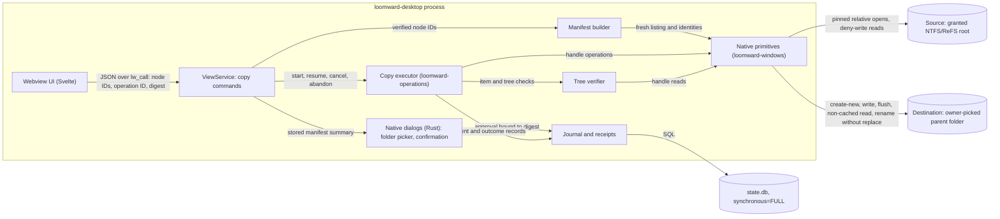
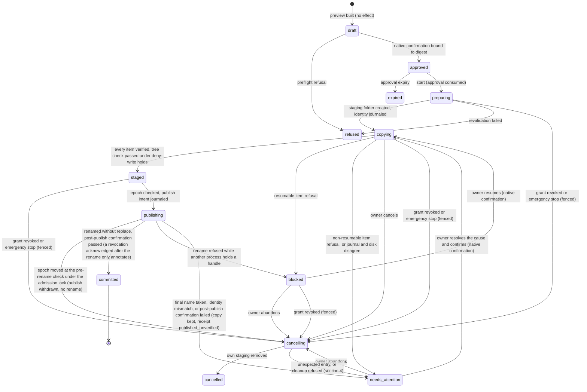

# Copy-and-verify: the first file effect

Status: **design, proposed 2026-10-12** (ADR-V3-25 in [42](42-v03-adrs.md)). Owner decision HUMAN_TODO q-32
(2026-10-12): copy with verification, never deleting the source, behind its own safety gate. C1's read-only verifier
is implemented (section 11); copy effects remain design, and AGENTS.md invariant 1 stays closed. Windows behaviours below are cited from Microsoft
documentation (section 14) or listed as a hypothesis to measure (section 13). It extends [08](08-transactions-recovery.md)
(lifecycle), [05](05-safety-security.md) (regression classes) and the backlog items LW-038 (#43), LW-039 (#45),
LW-040 (#46) and LW-041 (#47). The readiness bar for effects is doc 45, written in a parallel lane; section 11 lists
what this operation brings to it.

## 1. What the operation is

Copy an owner-selected set of ordinary files and folders from owner-granted, identity-verified (NTFS or ReFS) roots
into **one new folder** that Loomward creates inside an owner-picked destination folder, verify every byte and every
preserved metadata class against what was read, and only then make the new folder appear under its final name.
The source is never written, renamed, moved or deleted. No existing destination entry is ever replaced. The only
thing Loomward ever removes is its own unpublished staging, matched by the file identities it recorded.

What it is not: a move, a sync, a backup (a copy on the same disk does not protect against that disk, doc 09), a
merge into an existing folder, or a way to free space. The receipt says "no space was freed on the source".

## 2. Options considered

| Option | Benefits | Costs | Risks | Reversibility |
|---|---|---|---|---|
| A. Do nothing; verify-only (owner copies with Explorer or robocopy, Loomward compares the two trees read-only) | No write code at all; reuses the q-10 content reader; useful on its own | Does not meet q-32 (a copy Loomward makes); no staging, so a half-finished copy looks like a finished one | None new | Two-way |
| B. `CopyFile2` / `CopyFileEx` per file, then verify | Least code; the OS copies streams, EAs and attributes [W6] | Paths, not handles: a junction swapped between our check and its open retargets the copy (doc 05, "Reparse points and path races"); no no-recall flag, so a placeholder source can hydrate; metadata behaviour is the OS's and changes by version (offload, sparse, reparse flags [W7]); progress-cancel deletes the partial file itself [W6] | Silent reach (recall) and path races, which are invariants 2 and 5 | Two-way |
| C. Own handle-based copy: pinned relative opens, deny-write source, create-new destination in a staging folder, write-ahead journal, non-cached read-back, rename without replace (**chosen**) | Every open is bound to the identities the owner approved; refusals happen before a write handle exists; group publish is one atomic rename; recovery is decidable from journal plus disk | Most code; we own metadata fidelity class by class; a delete primitive (staging only) enters the codebase | Bugs in our own writer, so the crash and fault matrix is the gate | Two-way (code); copies already published stay on disk |
| D. Spawn robocopy (`/COPY:DAT /J /XJ`) | Mature copier | A process effect and a shell surface (invariant 1 forbids a general execute path); path-based; log parsing as evidence | Same path races as B, plus argument injection through names | Two-way |

A survives as lane C1 (section 11): the read-only tree verifier is built first, and C reuses it.

## 3. Components (one container: `loomward-desktop`, or `loomward-serve` for synthetic sessions)

Crate placement follows ADR-V3-02: every `unsafe` call lives in `loomward-windows` (a new `effects` module beside
`duplicate_reader`); the pure state machine, journal and recovery reader live in the new `loomward-operations`
crate named by LW-039/LW-040; wiring and policy live in `loomward-service`. MCP gets nothing (invariant 7).

## 4. Native API choices on Windows

**Source opens.** Reuse the q-10 reader's path: root pins from `root_handles`, then each component opened relative
to its pinned parent with `NtCreateFile` and `FILE_OPEN_REPARSE_POINT | FILE_OPEN_NO_RECALL`
(`crates/loomward-windows/src/enumerate/native.rs:188-251`; relative names via `RootDirectory` [W1]). Metadata
handle first, so a refused class never gets a content handle (`duplicate_reader/native.rs:159-172`). The content
handle shares only `FILE_SHARE_READ | FILE_SHARE_DELETE` (`duplicate_reader/native.rs:173-181`): an existing
writer makes the open fail (`source_in_use`) and no new writer can open while we read. The before/after signature
(object key, size, last-write, change time, attributes, link count, ancestors; `duplicate_reader/native.rs:67-75`)
and the reopen-by-name through pinned parents (`duplicate_reader/native.rs:207-219`) are reused unchanged.

**Destination creates.** The destination parent is pinned like a root. The staging folder and everything in it are
created relative to their parent handle with `NtCreateFile` and `FILE_CREATE`, which fails if the name exists and
never opens or replaces an existing object [W1]; files add `FILE_NON_DIRECTORY_FILE`, folders
`FILE_DIRECTORY_FILE`. The security descriptor argument is NULL, so the new object takes the ACL the file system
propagates from its parent [W1], which is what Explorer does for a copy [W11]. Creating and writing are separate
steps: a batch of up to 256 items is created empty, their identities (file ID, creation time) are committed to the
journal, and only then is any of them preallocated or written (section 5). Each file is preallocated to its size
(`FileAllocationInfo` through `SetFileInformationByHandle` [W16]) so a full disk fails before data is written, not
halfway.

**Writes and flush.** Buffered sequential writes in 1 MiB chunks, then `FlushFileBuffers` once per file (needs
`GENERIC_WRITE` [W4]). Not `FILE_FLAG_WRITE_THROUGH` per write: Microsoft's own guidance is unbuffered plus
write-through for many small durable writes [W4], but a single flush per file is cheaper and the read-back below is
the proof. The volume-wide flush needs administrator rights [W4] and is not used (invariant 2: never elevated).

**Read-back.** After the flush and the metadata step, the file is reopened by its recorded ID with `OpenFileById`
(volume hint = the pinned destination parent [W2]) using `FILE_FLAG_NO_BUFFERING | FILE_FLAG_OPEN_NO_RECALL |
FILE_FLAG_OPEN_REPARSE_POINT`, read in chunks that are multiples of the physical sector size from aligned buffers
[W2][W3] (physical sector size from `IOCTL_STORAGE_QUERY_PROPERTY` [W3]), and hashed. This proves the bytes are
readable below the system cache. It does not prove they are on the platter: the device's own cache is outside the
system's control [W3]. That limit is stated in every receipt.

**Hash.** SHA-256 (the `sha2` crate already in the workspace and used by the q-10 reader). One digest per stream,
computed on the exact buffers written; the destination digest comes from the independent read-back. BLAKE3 would be
faster but adds a dependency for a CPU cost that is below disk speed on this class of machine (assumption; measure in
C2).

**Named streams.** Enumerated by handle with `FileStreamInfo` [W8]. Each named `$DATA` stream (for example the
`Zone.Identifier` mark of the web, which must survive a copy) is opened relative to the open file handle with the
name `:<stream>` and copied and hashed like the default stream. Relative stream opens are not spelled out on the
`NtCreateFile` page, so this is hypothesis H1; if it fails, files with named streams are refused
(`alternate_streams_unsupported`), never copied without them.

**Metadata.** Set with `SetFileInformationByHandle(FileBasicInfo)` [W16] after all stream writes (a later write
would move the last-write time), then flushed again, because file metadata may still be cached [W2]. Directory
times are set bottom-up after their children are verified.

**Publish.** One `SetFileInformationByHandle(FileRenameInfo)` on the staging folder handle with
`ReplaceIfExists = FALSE`, which returns an error when the target exists [W5]. Staging and final names share the
same parent, so the rename is a same-directory name change on one volume and atomic from a reader's view.

**Holding staged content from the final check to the receipt.** Staged children inherit the destination ACL, so
another process in the same account could change a staged file between the final tree check and the rename. The
protocol closes that window in two parts: hold, then confirm.

1. **Hold.** The final tree check reopens every staged file by its journaled ID with read access and share mode
   `FILE_SHARE_READ | FILE_SHARE_DELETE`, never `FILE_SHARE_WRITE`. That open fails if anyone already has the file
   open for write (`staging_in_use`, resumable), and while it is held no one can open the file for write [W2]. The
   final content hash is taken through that held handle (non-cached), so the bytes verified are the bytes held. The
   holds stay open until the `committed` record (up to 200,000 handles; assumption, measured in C2).
2. **Publish with holds, if H2 allows.** If H2 shows that held children opened with `FILE_SHARE_DELETE` do not block
   renaming their ancestor, the rename is issued with every hold in place. If H2 shows they do, the holds are released
   just before the rename and reacquired by ID straight after it. Content can change only in that gap, and step 3
   then re-hashes every file.
3. **Confirm after publish.** Under the holds, still held or reacquired, a post-publish confirmation checks four
   things:
   - the published tree's entries, names and IDs against the manifest, with no extras;
   - each item's preserved metadata (section 6), because share modes do not stop a holder of write-attributes
     access from changing times or attributes;
   - that the final folder's identity equals the staging identity;
   - content, re-hashed, but only on the H2-negative path.

   Only then is `committed` journaled and a verified receipt issued. Any difference fails closed: nothing is
   recorded as verified or committed for the changed items, the run goes to `needs_attention`, and the receipt
   outcome is `published_unverified`. The published copy is kept, because a published copy is never removed.

**Staging removal.** Only on cancel, abandon or a redo after a failed item. Only inside the staging folder whose
identity was journaled, and only for entries whose identity was journaled. Before touching any entry, cleanup checks
two things and refuses outright, with the operation going to `needs_attention`, if either fails:

- the staging name, opened relative to the pinned destination parent, must still resolve to the journaled staging
  identity;
- the run must hold no publish intent that has not been withdrawn (section 5).

A folder that has been renamed to its final name is therefore never reached by following IDs, and a published copy
is never removed. Each entry is then opened by ID [W2], and its
creation time must match the journal. Its manifest name must still resolve to that same ID through the pinned
staging handle. It is then removed with a POSIX-semantics disposition [W14]. Staged files can carry the read-only
attribute (section 6), and a read-only file refuses deletion [W14]. So the disposition sets
`FILE_DISPOSITION_IGNORE_READONLY_ATTRIBUTE` [W14] together with `DELETE | POSIX_SEMANTICS` (H6). Where that flag is
unsupported, the read-only bit is first cleared with `FileBasicInfo` [W16] on the same identity-verified handle. A
mapped view also blocks deletion [W14]: cleanup then stops with that entry kept, and the operation goes to
`needs_attention`. Anything without a journaled identity, or whose checks fail, is left alone and reported. A file
someone created after a crash under a manifest name is therefore never deleted.

**Checks.** Cloud sync root: `CfGetSyncRootInfoByHandle` needs only read-attributes access and fails when the item
is not under a sync root [W9]; success on the destination parent refuses the copy (writing there would upload,
invariant 2). Placeholder and offline attributes [W10] reuse `refused_attributes`
(`enumerate/mod.rs:197-199`). Case sensitivity: `FileCaseSensitiveInfo` [W17] on every source folder and the
destination parent; new folders inherit the flag from their parent [W12]. Free space: `GetDiskFreeSpaceExW`
caller-available bytes [W15]. File system: `verifies_identity` (`enumerate/mod.rs:118-120`).

## 5. State machine

Items move `pending -> created -> written -> metadata_set -> verified`, or to `failed(reason)`. A verification
mismatch retries that item once from zero (new staging object, old one removed by identity); a second mismatch is
`needs_attention`, never a silent pass.

`needs_attention -> copying` is allowed only when the owner has resolved a cause outside Loomward and confirms in the
native dialog. Such causes are removing an unjournaled leftover, or moving away an entry that took the final name.
Resume then re-runs every start check and continues from the first unverified item. When every item is already
verified, it passes straight through `staged` to `publishing`. A cause Loomward cannot recheck to its original state,
such as `source_changed`, has only one exit: Abandon. A new preview makes a new operation.

**Write-ahead order and recovery.** Every effect has its intent committed to `state.db` (`synchronous=FULL`,
ADR-V3-22) before it happens and its outcome after. Loomward has cleanup authority over an entry only when its
identity is in the journal. Nothing is ever adopted by name. Three ordering rules follow from that:

- The staging folder's identity is committed before anything is created inside it.
- Each item's identity is committed right after its empty create and before any byte is written or preallocated.
  Creates are batched, up to 256 items per identity commit.
- `verified` records may be group-committed (every 256 items or 250 ms), because a missing one only causes a re-check.

The journal stores a per-operation head (last sequence and chain hash) in the same SQLite transaction as
each append, including `started`. Store replay and recovery compare the tail with that head in one read
snapshot; a mismatch or missing head is `needs_attention`, never an earlier Resume or Confirm. Operations
whose rows were all lost remain listed by their head. Inserts over an existing `(op_id, seq)` are refused
before SQLite's REPLACE conflict handling, and updates and deletes are refused by triggers.

On the first open of a legacy database without the head table, Store creates the table and anchors each
current tail in one `BEGIN IMMEDIATE` transaction. This preserves existing synthetic C5 sessions without
rewriting their journals. Legacy tail loss before this migration cannot be detected retrospectively; the
existing hash chain and state-machine validation still apply. Once the table exists, opens never fill
missing heads or rewrite mismatching ones. The anchor detects independent journal damage, not coordinated
rewriting of both the journal and its head or restoration of an older whole database. Transaction rollback
tests inject a head-write failure after the row insert; real power-cut evidence remains the G5 gate.

Two `Store` connections to one `state.db` in the same process (for example a copy worker that outlived its
bounded join, and a later open of the same state directory) serialise on the write lock: each append takes
`BEGIN IMMEDIATE` with the 5 s busy timeout and re-reads head and tail under that lock. A cached replay is
reused only while the stored tail still matches it, so a stale connection's append is either validated
against the journal as it now stands or refused (busy, head mismatch, stale epoch); it never forks the chain.
Tests: `tests/head_anchor_concurrency.rs`.

| Crash between | Disk shows | Recovery decides |
|---|---|---|
| approval consumed and staging intent | nothing | `approved` again only with a fresh confirmation; else `cancelled` |
| staging intent and its identity record | possibly an empty folder carrying this attempt's random token | never adopted or deleted: the next attempt makes a new staging folder with a new token; the receipt names the possible empty leftover for the owner to remove |
| item create batch and its identity commit | empty files under manifest names, identities not journaled | never adopted or deleted (a file someone created after the crash under that name would look the same); each such name is reported and the operation waits in `needs_attention` until the owner removes it, then resumes |
| identity commit and `verified` | partial or unverified file with a journaled identity | reopen by ID; creation time and name-to-ID must match (section 4); remove it and redo the item; on any mismatch, `needs_attention` and touch nothing |
| `verified` batch and next batch | verified files | re-verify (non-cached read-back) only the unrecorded ones |
| publish intent and rename | staging name present with its identity | on owner Resume, re-read the epoch: unchanged, rename again; moved, journal `publish_withdrawn` and cancel |
| rename and `committed` | final name with the staging identity; holds lost with the process | reacquire holds by ID and run the post-publish confirmation with a full content re-hash; pass, record `committed` (epoch-exempt) and write the receipt, noting any revocation; fail, `needs_attention` with outcome `published_unverified`; never cleanup |
| rename and `committed` | final name with another identity, staging gone | `needs_attention` (someone else acted), touch nothing |

**Revocation and emergency stop.** Doc 05 requires every consequential step to recheck grants, and an emergency
stop to halt cooperative work at documented boundaries. ADR-V3-22 commits a revocation before it cancels anything,
then fences later messages. The copy run follows the same pattern, with one addition. A fence check followed by an OS call is not atomic on its own, so the two are serialised through a per-run
**admission lock** (an in-process lock; the engine is one process, ADR-V3-01).

1. **Effect steps.** The executor runs every effect as one step. A step takes the lock, reads the epoch, issues
   exactly one bounded effect call and releases the lock. The bounded calls are: one create, one write of at most
   1 MiB, one flush, one metadata set, or the rename. Steps happen at every cooperative boundary: each item open,
   each chunk, before each identity or `verified` commit, the publish intent, and the rename itself. The rename
   step's epoch read is therefore the pre-rename check (HIGH fix (d)).
2. **Revocation.** Revoking a source grant, or pressing emergency stop, runs in this order:
   1. commit the revocation and bump the run's fence epoch in `state.db`, marking the approval unusable;
   2. acquire the run's admission lock, which waits for at most one in-flight step;
   3. read and journal the run's position (`stopped_before_publish`, or `published`);
   4. release the lock and return the acknowledgement.
3. **Acknowledgement semantics.** An acknowledged revocation means four things:
   1. the revocation is durable;
   2. no effect step of the run starts after the acknowledgement, because every later step reads the new epoch under
      the lock;
   3. at most one step that was already in flight completed before it, and the acknowledgement names that step;
   4. the acknowledgement says which side of publish the run is on.

   If a step does not return within 30 s (stuck I/O), the revocation is reported as `pending_in_flight_step`, not
   acknowledged. It is acknowledged when the step returns (assumption: 30 s, measured in C2).
4. **Before publish.** Up to and including the rename step's epoch read, a moved epoch means:
   - no further create, write, metadata change or rename;
   - close the source handles, journal `revoked`, and go to `cancelling`;
   - if a publish intent was already journaled, withdraw it (`publish_withdrawn`) in the same transaction, so no
     rename is issued;
   - the only effect still allowed is removing Loomward's own journaled staging (section 4). Cleanup steps also take
     the lock but are not fenced.
5. **After the rename.** Once the rename step has read an unchanged epoch, the rename completes inside that step.
   A revocation can only be acknowledged after it, and the fence no longer cancels: the post-publish confirmation
   (section 4) still runs, because it is a read of the destination and not an effect. The receipt is annotated
   `revoked_after_publish` with the acknowledgement time (HIGH fix (a)).
6. **Stale records.** The journal rejects any later item or publish-intent record that carries the old epoch, so a
   worker still in flight cannot advance the run. Four records are exempt from the epoch check: `committed`,
   `revoked`, `publish_withdrawn`, and the cleanup records (HIGH fix (b)).
7. **Resume.** Resume is refused (`grant_revoked`). A new grant needs a new preview and a new approval.

An identity change that ends a source or destination grant fences its copies under the same service
mutation lock as revocation. It uses the same journal cause and receipt annotation, `grant_revoked`:
before rename the run cancels; after rename it confirms and commits with the annotation.

Cancel and Abandon request cooperative cancellation and wait up to 30 s for the worker to finish.
If a source read is still stuck, they return `busy` with reason `pending_in_flight_step`, release the
service mutation lock and keep the cancel-requested run registered. This is not a cancelled receipt:
the run settles when the read returns, and `copy.status` reports its actual state.

How revocation meets publish:

- **Acknowledged before the rename step takes the lock**, whether before or after the publish intent: the step reads
  the new epoch, the intent (if any) is withdrawn, there is no rename, and the run is cancelled.
- **Requested while the rename step holds the lock:** the acknowledgement waits for the rename to return, then
  reports `published`. The run goes on to confirmation and `committed`, annotated.
- **After a crash between the rename and `committed`:** recovery finds the final name carrying the staging identity
  and confirms (section 5 table). It never cancels, even if a revocation landed meanwhile.

The rename is atomic. Cleanup refuses whenever the staging name no longer resolves to the staging identity, or a
publish intent is not withdrawn (section 4, HIGH fix (c)). So no path can remove a published copy, and no publish
starts after a revocation is acknowledged.

A restart never resumes an effect by itself: interrupted operations wait in a banner for Resume (native
confirmation) or Abandon. Resume revalidates grants, destination identity, space and each pending source signature;
the manifest digest is unchanged, so no fresh preview is needed unless a source changed.

## 6. Metadata policy (v1)

| Class | Policy | Verified by |
|---|---|---|
| Default data stream | copied | SHA-256 of bytes read vs non-cached read-back |
| Named `$DATA` streams | copied, at most 64 per file (H1) | per-stream SHA-256 and size |
| Size | exact | `FileStandardInfo` end of file |
| Creation and last-write times | preserved | equality after reopen by ID (H4) |
| Last-access time | best effort, not verified | reported |
| Change time | not preserved (the file system owns it) | reported |
| Read-only, hidden, archive, not-content-indexed | preserved | attribute mask equality |
| System, temporary, compressed, sparse, encrypted, integrity stream | refused | refusal before any write handle |
| Extended attributes | refused | `FileEaInfo` size > 0 |
| Reparse points of any tag (links, junctions, cloud, dedup) | refused, whole group | attribute and tag check |
| Security descriptor | not copied; inherited from the destination [W11] | destination has no explicit ACEs (H5); preview counts sources that had explicit ACEs |
| Owner | the current user | reported |
| Hard-link sets | each name becomes an independent file | preview counts names with link count > 1 |
| Folder times and preserved attributes | set bottom-up | same checks as files |
| Per-folder case sensitivity, object IDs, short names | not preserved | reported |

Doc 05 rule kept: an unsupported class blocks execution rather than silently becoming a plain file. Widening any row
needs fixtures and a review, not a flag.

## 7. Refusals

Checked at preview (P), at start or resume (S) and per item at open (I). "Resumable" means the operation waits in
`blocked` with staging kept.

| Code | Cause | When | Resumable |
|---|---|---|---|
| `identity_unverified` | source or destination not NTFS/ReFS (FAT, exFAT, unknown; #219 rows never back an effect) | P, S | no |
| `cloud_placeholder` | offline or recall attributes, cloud reparse tag; never recalled | P, I | no; at I the run goes to `needs_attention`, staging kept |
| `reparse_point` | any other reparse tag in the group | P, I | no; at I the run goes to `needs_attention`, staging kept |
| `unsupported_attribute`, `extended_attributes`, `alternate_streams_unsupported`, `too_many_streams` | section 6 | P, I | no; at I the run goes to `needs_attention`, staging kept |
| `special_file` | handle is not a disk file (`duplicate_reader/native.rs:196-198`) | I | no; the run goes to `needs_attention`, staging kept |
| `source_changed` | signature differs from the manifest, or the name no longer reaches the object | S, I | no; at I the run goes to `needs_attention`, staging kept; only exit Abandon, then a new preview |
| `staging_name_taken` | `FILE_CREATE` of an item fails on create or resume because the name is taken in staging (an unjournaled leftover or someone else's entry) [W1] | I | after the owner removes the entry: the run goes to `needs_attention`, then `copying` on confirmation |
| `staging_in_use` | a staged file is open for write elsewhere when the final check takes its deny-write hold (section 4) | I | yes |
| `changed_after_verification` | the post-publish confirmation finds a change (section 4) | publish | no; the run goes to `needs_attention`, outcome `published_unverified`, copy kept |
| `source_in_use` | sharing violation on the deny-write open | I | yes |
| `access_denied` | source unreadable, or destination write blocked (for example by Controlled Folder Access) | I | yes |
| `insufficient_space` | caller-available bytes < need + reserve, or preallocation failed | P, S, I | yes |
| `destination_inside_source` | a copied folder is the destination parent or one of its ancestors (compared by identity) | P, S | no |
| `destination_cloud_synced`, `destination_unsupported_volume`, `destination_protected` | sync root; removable, network or non-NTFS/ReFS volume; state directory or the scan fences of #284/#286 | P, S | no |
| `case_collision` | two names fold equal under the destination's rules (CompareStringOrdinal, ignore case) | P | no |
| `name_unrepresentable` | reserved device name, trailing dot or space, component over 255 units [W13] | P | no |
| `path_too_long` | final path over 32,767 units [W13] (over 259 is a warning: many apps and the shell cannot open it [W13]) | P | no |
| `publish_in_use` | rename refused while another process holds a handle under staging (H2) | publish | yes, after 10 tries over 30 s |
| `verification_mismatch` | hash or metadata differs twice | I | no: `needs_attention` |
| `grant_revoked` | a source grant revoked, or emergency stop (section 5) | P, S, then every cooperative boundary | no: cancels the run |
| `elevated`, `approval_expired`, `digest_mismatch`, `manifest_limit` | authority checks; limit 200,000 entries per operation (assumption) | P, S | no |

**Preflight versus runtime refusals.** A refusal raised at P or S comes before the operation's first effect, so no
write handle exists. That covers every code with a P or S entry, including the first check of codes that are checked
again later. A refusal raised at I, at a cooperative boundary or at publish happens after effects have started. For
those the rule is **no further effects**:

- once the refusal is journaled, no new create, write, metadata change or rename happens for that item;
- for every code except the resumable ones, nothing more happens for the operation either;
- sources are never touched;
- staging already written is kept, except for identity-bound removal on cancel, abandon or the single permitted redo;
- `verification_mismatch` allows exactly one redo of that item, then stops;
- `publish_in_use` allows only the bounded rename retries;
- the receipt names the item, the code and the last journaled state.

Where a runtime refusal leaves the run: a resumable code sends it to `blocked`, with staging kept and Resume or
Abandon offered. A non-resumable code sends it to `needs_attention`, with staging kept, and Abandon is the exit
unless the owner can resolve the cause (section 5). Both keep the no-further-effects rule.

Destination name: the server proposes it (the single top source name, else "Loomward copy" plus the date) and adds
" (2)", " (3)" when the parent already has it, so a new-folder copy never needs an overwrite. Space need is the
cluster-rounded size of every stream plus 4 KiB per folder; the reserve is the larger of 1 GiB and 1% of the
volume (assumption, to be measured in C5).

## 8. Failure modes

| Failure | Detection | Response | Proof |
|---|---|---|---|
| Process crash or kill at any step | non-terminal journal state at start | section 5 table; wait for owner | C6 crash matrix |
| Power loss | same, plus files the OS had not flushed | redo unverified items; re-verify the last batch | G5: real power-cut runs (Q2); lab-only until they pass |
| Grant revoked or emergency stop mid-run | fence epoch read under the admission lock at every step | acknowledged only after the in-flight step; no step starts afterwards; before publish: cancel, own staging removed; after the rename: commit, annotated | lab test revoking at each boundary; stale-epoch record rejected; publish barrier test (section 10) |
| Revocation, or a crash followed by a revoke, between the rename and `committed` | final name holds the staging identity; staging name gone | `committed` is epoch-exempt; cleanup refuses; receipt annotated | revoke at CP-13 and after a crash at CP-13; the published copy must survive byte-identical |
| Staged file changed between the final check and the receipt | deny-write holds; post-publish confirmation | no verified or committed receipt for changed bytes; `needs_attention`, `published_unverified`; copy kept | publish TOCTOU test (section 10) |
| Same-name entry appears in staging after a crash | identity not in the journal | never deleted or adopted; `needs_attention` | crash at the create batch, then a file planted under that name |
| Read-only staged file during cleanup | deletion refused [W14] | ignore-read-only disposition, or clear the bit on the verified handle (H6) | native test |
| Source edited after preview | signature mismatch | `source_changed`, re-preview | real edit fixture |
| Source edited during copy | deny-write open excludes new writers; an existing writer fails the open | `source_in_use` | real writer fixture |
| Source renamed or deleted during copy | reopen through pinned parents fails | `source_changed` | real rename fixture |
| Junction swapped onto an ancestor | relative opens refuse reparse; ancestor identities differ | `source_changed` / `reparse_point` | real `mklink /J` fixture (no elevation) |
| Destination parent renamed or replaced | pinned handle; identity recheck at start, resume and publish | refuse, `needs_attention` | real fixture |
| Disk fills | preallocation fails | `insufficient_space`, staging kept | injected error, plus a small real volume if Q2 provides one |
| Bit flip or torn write in staging | non-cached read-back hash | retry once, then `needs_attention` | real corruption: flip a byte through a second handle before verify |
| Final name created by someone else | rename returns an error [W5] | `needs_attention`, staging kept | real race fixture |
| Antivirus holds a staged file | rename refused (H2) | bounded retry, then `blocked` | real held-handle fixture |
| Journal write fails (`state.db` full or locked) | SQLite error before the effect | stop before the effect; no effect without its intent | injected |
| Operator cancels | cancel flag at chunk boundaries | staging removed by identity | unit plus lab |
| Bug writes outside staging | create-new relative to staging only; the C6 oracle snapshots the destination parent | test failure blocks the gate | C6 oracle |

## 9. UI flow

1. The owner selects items in any view and chooses **Copy to...**.
2. A Rust-side folder picker returns the destination parent (the path never crosses IPC, ADR-V3-08; the q-15 save
   dialog work is the same pattern).
3. The preview shows: items, folders, bytes, refusals with reasons (deselecting builds a new manifest), the proposed
   folder name, "same disk: not protection against disk failure" or "different disk", the metadata summary
   ("permissions come from the destination; 12 items had their own"), space before and after, and "no space is freed
   on the source".
4. **Copy** opens a native confirmation rendered from the stored manifest (not from the webview), showing the
   digest's last 8 characters. Confirm writes the approval (single use, 30-minute expiry, assumption).
   An unapproved stored preview also expires after 30 minutes; approval then refuses with `preview_expired`
   and requires a new preview, even if no later preview has triggered cache eviction.
5. Progress shows phases (preparing, copying n of m, verifying, publishing), bytes, rate and **Cancel** (until
   publishing starts).
6. The result shows the receipt: completed and verified, or blocked (reason, Resume, Abandon), or needs attention
   (what was found, what was left untouched).
7. On start, interrupted operations appear in a banner with Resume and Abandon. Nothing resumes by itself.

Synthetic sessions (`loomward-serve`) may approve over HTTP, only for registered lab roots and a destination inside a
registered lab root, so Playwright and agents can test end to end. Personal sessions need the native dialog; the
HTTP adapter refuses personal approvals, as it does personal disclosure grants (ADR-V3-08, ADR-V3-15).

## 10. Test plan

- **Unit (pure, any platform).** Every state transition and its illegal neighbours; the recovery decision table in
  section 5 as table-driven tests; refusal classification from attribute, tag and name fixtures; case folding;
  canonical manifest digest (order, normalisation, byte strings per ADR-V3-04); approval expiry, single use,
  revocation.
- **Native (Windows, tempdir).** Create-new collision; rename without replace onto an existing name; non-cached
  read-back at sizes 0, 1, 511, 512, 4095, 4096, 4097, 1 MiB + 1 and above 4 GiB; stream enumeration and copy;
  basic-info set and verify; staging removal refuses an identity mismatch and a same-name replacement, and removes a
  read-only staged file (H6); sync-root check negative; elevated refusal (as `win.rs:4-13`).
- **Lab (synthetic roots, `loomward-lab`).** A 10,000-entry tree with mixed sizes, named streams, hidden and
  read-only items, Unicode and 255-unit names, paths over 260, hard links; refusal trees with junctions, sparse,
  compressed and encrypted files, case-sensitive folders with case-only duplicates. The C1 verifier, run
  independently, must agree with each receipt, and the source snapshot (hashes and signatures) must be unchanged.
- **Fault (injected).** A `fault-points` cargo feature, compiled only into test builds, lets a named point return
  an error (disk full, access denied, sharing violation, stream open unsupported, journal error).
- **Crash ("power cut" by process kill).** The harness runs the executor in a child process; at each crash point
  CP-01 to CP-15 (every journal boundary in section 5, plus mid-write at four offsets, mid-verify and mid-abandon) the child
  signals over a pipe and blocks, and the parent calls `TerminateProcess`. A new process runs recovery, then resume
  or abandon. Plus at least 200 kills at random times. Oracle after every run: the source is byte- and
  signature-identical; nothing in the destination parent changed except the staging or final folder; no receipt says
  completed unless the C1 verifier agrees; abandon leaves the parent exactly as before. A process kill keeps the OS
  cache, so it proves crash consistency, **not** power-loss durability.
- **Publish TOCTOU regression.** Pause at a fault point after the final tree check. A second process then tries
  four mutations against a staged file:
  - open it for write and change one byte;
  - change its last-write time and attributes through write-attributes access;
  - rename a staged child;
  - add a file inside staging.

  Then release the pause. Run this once per H2 outcome, holds kept and holds released around the rename. Required:
  - while holds are in place, the open for write fails;
  - every mutation that does succeed is caught by the post-publish confirmation;
  - no `verified` record and no `committed` receipt ever covers changed bytes, metadata or tree shape;
  - the published copy is not removed.
- **Publish barrier test (revocation linearisation).** Pause after the rename step has taken the admission lock but
  before its epoch read. In a second thread, after the final epoch check and the committed publish intent, commit a
  revoke and wait for its acknowledgement while the pause holds the lock, then release. Required:
  - the acknowledgement arrives only after the lock is released;
  - the rename step reads the new epoch and issues no rename (`publish_withdrawn`, cancelled);
  - no publish happens after the acknowledgement.

  The mirror case pauses inside the rename step after its epoch read. There the acknowledgement must wait for the
  rename and report `published`.
- **Power cut (real, mandatory per HUMAN_TODO q-39).** Use the method the owner picks in Q2. Run at least 20 hard
  power-offs at random points during lab copies, including inside the create-batch, publish and cleanup windows.
  After each, boot, recover and resume or abandon, then apply the same oracle as the crash runs.
- **Proven restore (mandatory per q-39).** Take a copy committed after a power-cut run. Copy it back with this
  operation to a new lab location. The C1 verifier must then match that copy against the original source manifest:
  content and every preserved class in section 6.
- **UI.** Model unit tests; Playwright on a synthetic session: preview, refusals shown, approve over HTTP, progress,
  receipt, interrupted banner after a killed server.

## 11. Lanes (each one PR) and acceptance evidence

| Lane | Delivers | Effect? | Acceptance evidence |
|---|---|---|---|
| C1 Tree verifier | read-only comparison of two granted trees (content and section 6 classes), reusing the q-10 reader; also the ADR-V3-23 stage 3 comparator | none | lab trees with planted differences found exactly; a test asserts no write access is ever requested |
| C2 Native primitives | section 4 in `loomward-windows::effects`; measures H1 to H5 | tempdir tests only, no command reaches it | native tests; `evidence/v3/copy-primitives.md` with H1 to H5 results |
| C3 Journal and state machine (LW-039, #45) | `loomward-operations`, recovery reader, `state.db` tables (designed by `data-modeler`) | none | unit and property tests; truncated or invalid records go to `needs_attention` |
| C4 Manifest and consent (LW-038, #43) | preview builder, refusal classifier, digest, approval and destination grant, copy commands (designed by `api-designer`) | none | contract examples; changed membership, destination or bytes invalidate approval |
| C5 Executor on lab roots (LW-040, #46) | C2 to C4 wired, synthetic sessions only | lab roots only | lab suite green; receipts agree with C1; throughput recorded |
| C6 Fault and crash matrix (LW-041, #47) | harness, injected and real faults, crash points | lab roots only | `evidence/v3/copy-faults.md`: every CP x resume/abandon, 200+ random kills, zero source changes, zero false-complete receipts |
| C7 UI | section 9 against synthetic sessions | none new | Playwright and unit tests |
| C8 Gate (session driver) | personal wiring, native confirmation, AGENTS.md invariant 1 text, docs/16 and CHECKPOINT | personal, owner-approved | all of the evidence list below; second-lens review |

C1, C2 and C3 run in parallel; C4 follows C3's schema; C5 needs C2 to C4; C6 needs C5; C7 needs C4; C8 needs C6,
C7, the G5 and G9 runs, and the doc 45 readiness bar. **Until G5 and G9 pass, the operation stays lab-only**: C5 to
C7 run on synthetic sessions, and C8 does not open, whatever else is green.

**C1 implementation seam.** `loomward-operations::tree` compares observations without I/O;
`Engine::compare_trees` admits both durable grants through the q-10 gate before asking the existing
`loomward-windows::duplicate_reader` for bounded observations. Exact relative native names, including empty
folders, are compared. Default and named file streams use full SHA-256 reads. Section 6 preserved classes
require equality, refused classes remain refusals even when both sides match, destination ACLs require no
explicit ACEs, and report-only classes retain both observations. A failed query, incomplete listing, changed
identity, exhausted budget or unsupported class remains unknown and prevents an equal report. Directory
named streams currently remain explicitly unsupported. This is observation-time evidence, not a durable
read-back, restore receipt or permission to retire a source. C1 exposes no service, HTTP, IPC or MCP command
and opens no effect gate.

**C5 implementation seam.** `loomward-windows::effects::exec` wires C2, C3 and C4; `loomward-service`
serves the copy commands to synthetic sessions on registered lab roots only, and personal sessions keep
`copy_effect_gated`. Q1 stays open: by default (`loomward-copy-staging-removal` off) cancel and abandon
journal `staging_left` and report the staging folder's name; identity-bound removal is the opt-in.
Creation times are journaled (`planned`) before they are set, and recovery attaches only by journaled
file ID with the original or planned creation time. Measured in C5: a held named-stream handle blocks the
ancestor rename (H2 negative for streams), so stream holds are released for publish and the streams
re-hashed after it. Revocation follows section 5 (#526): each plan names its grants, a revoke fences
the journal, and every effect step reads the fence under the run's admission lock; H7 measured positive
on NTFS. `copy.start` re-checks its grants and registers the run under the same lock a revocation
holds, so a revoke either refuses the start or fences the live run. A revocation waits up to 30 s per
running copy for its in-flight step, then waits up to 30 s for worker completion while holding that
lock (lab only; noted for C8). A worker still pending stays registered and fenced. Identity changes
use this same path. No resume yet: a stopped run exits by Abandon. Evidence:
`evidence/v3/copy-executor-lab.md`.

**Gate evidence (what C8 must show, beside doc 45's bar and HUMAN_TODO q-39).**

- **G1.** The lab suite (C5).
- **G2.** The crash matrix (C6).
- **G3.** Each failure-mode row's proof.
- **G4.** Each preflight-capable refusal (every code with a P or S entry in section 7) is shown on a fixture to be
  refused before any write handle exists. Each runtime refusal (`source_in_use`, `access_denied`, `special_file`,
  item-time `source_changed`, `cloud_placeholder` and attribute codes, preallocation `insufficient_space`,
  mid-run `grant_revoked`, `publish_in_use`, `verification_mismatch`) is shown to follow section 7's no-further-effects
  rule. The oracle checks there is no create, write, metadata change or rename after the refusal's journal record,
  apart from the permitted redo, the bounded rename retries and identity-bound cleanup.
- **G5.** Real power-cut runs pass by the Q2 method (section 10). Without them the gate stays shut.
- **G6.** MCP has no copy command and HTTP refuses personal approvals (tests).
- **G7.** One owner-run copy of a small real folder in the desktop app, recorded with anonymised counts only.
- **G8.** A second, high-risk review lens on C2, C5 and C8.
- **G9.** The proven restore of section 10 passes.

## 12. Open questions for the owner

- **Q1 Staging removal.** Cancel and abandon delete Loomward's own unpublished staging files, matched by recorded
  identity and only inside its own staging folder. This is the first delete code path in Loomward. Recommended:
  allow it. Alternative: never delete anything, and leave the staging folder for you to remove in Explorer.
- **Q2 Power-cut proof method.** A process kill does not lose the OS cache, so it cannot prove durability after a
  power cut. Your readiness bar (q-39) makes a real power-cut proof mandatory before the gate opens. Options:
  - (a) A Hyper-V VM hard-stopped during lab copies. You enable Hyper-V once, which needs elevation; agents then run
    the cycles.
  - (b) You pull the power on a disposable test machine, or on this one, while it copies lab data only.
  - (c) Neither yet: copy-and-verify stays lab-only. C5 to C7 continue on synthetic sessions, and nothing opens for
    personal data.

  (c) never opens the gate. Recommended: (a), because it repeats cheaply and needs no physical action after setup.

### Open items for lane C2

Recorded from the final review of #423 and deliberately not resolved in this design:

- G4's runtime proofs should also cover the crash-then-redo path (a refusal, a crash, a resume) and not only the
  live path.
- Wording that says refusals come "before effects" (ADR-V3-25 consequences) predates the split between preflight and
  runtime refusals and should say "preflight refusals".
- The crash-point list CP-01 to CP-15 should be extended to cover the new boundaries: the identity commit of a
  create batch, the rename step's epoch read under the lock, `publish_withdrawn`, the post-publish confirmation and
  each cleanup removal.
- Which lane owns the G5 power-cut runs and the G9 proven restore (C6 or a separate lane) is not decided.
- The create-batch intent record should list the names it is about to create, so recovery can report leftovers
  precisely.
- Cleanup should check that a staged file's link count is 1 before removing it, so that a hard link someone added to
  a staged file is never removed by an unlink that looks like cleanup.
- **Q3 Destination shape.** v1 always creates a new folder (with " (2)" when the name exists) and never writes into
  an existing folder. Is that enough, or do you need copies into an existing folder (new names only, never
  overwriting)?

## 13. Hypotheses to measure (lane C2)

- **H1.** `NtCreateFile` with `RootDirectory` = an open file handle and the name `:<stream>` opens or creates that
  named stream on NTFS and ReFS.
- **H2.** Renaming a folder fails while another process holds a handle on a file beneath it; which error code; and
  whether Loomward's own deny-write holds (`FILE_SHARE_READ | FILE_SHARE_DELETE`) on the children block its own
  rename. That last answer picks the publish path in section 4.
- **H7.** A deny-write open fails while another process keeps a writable mapped section of the file after closing
  its handle, so a mapping cannot change held bytes.
- **H3.** A `FILE_FLAG_NO_BUFFERING` read by ID after `FlushFileBuffers` returns the written bytes, including the
  final partial sector (a short count at end of file).
- **H4.** Times set through `FileBasicInfo` after the last write survive close and reopen unchanged.
- **H5.** A file created with a NULL security descriptor under a folder with inherited ACEs carries only inherited
  ACEs.
- **H6.** `SetFileInformationByHandle(FileDispositionInfoEx)` with `FILE_DISPOSITION_FLAG_DELETE |
  FILE_DISPOSITION_FLAG_POSIX_SEMANTICS | FILE_DISPOSITION_FLAG_IGNORE_READONLY_ATTRIBUTE` removes a read-only staged
  file on NTFS and ReFS on this Windows build; otherwise clearing the bit with `FileBasicInfo` first works.

## 14. Sources

Re-read on 2026-10-12: [W1]-[W14]. Cited from the API reference without re-reading this pass: [W15]-[W17].

- [W1] NtCreateFile: https://learn.microsoft.com/en-us/windows/win32/api/winternl/nf-winternl-ntcreatefile
- [W2] OpenFileById: https://learn.microsoft.com/en-us/windows/win32/api/winbase/nf-winbase-openfilebyid
- [W3] File buffering: https://learn.microsoft.com/en-us/windows/win32/fileio/file-buffering
- [W4] FlushFileBuffers: https://learn.microsoft.com/en-us/windows/win32/api/fileapi/nf-fileapi-flushfilebuffers
- [W5] FILE_RENAME_INFO: https://learn.microsoft.com/en-us/windows/win32/api/winbase/ns-winbase-file_rename_info
- [W6] CopyFileExW: https://learn.microsoft.com/en-us/windows/win32/api/winbase/nf-winbase-copyfileexw
- [W7] COPYFILE2_EXTENDED_PARAMETERS: https://learn.microsoft.com/en-us/windows/win32/api/winbase/ns-winbase-copyfile2_extended_parameters
- [W8] FILE_STREAM_INFO: https://learn.microsoft.com/en-us/windows/win32/api/winbase/ns-winbase-file_stream_info
- [W9] CfGetSyncRootInfoByHandle: https://learn.microsoft.com/en-us/windows/win32/api/cfapi/nf-cfapi-cfgetsyncrootinfobyhandle
- [W10] File attribute constants: https://learn.microsoft.com/en-us/windows/win32/fileio/file-attribute-constants
- [W11] Permissions when you copy and move files: https://learn.microsoft.com/en-us/troubleshoot/windows-client/windows-security/permissions-on-copying-moving-files
- [W12] Case sensitivity: https://learn.microsoft.com/en-us/windows/wsl/case-sensitivity
- [W13] Maximum path length limitation: https://learn.microsoft.com/en-us/windows/win32/fileio/maximum-file-path-limitation
- [W14] FILE_DISPOSITION_INFORMATION_EX: https://learn.microsoft.com/en-us/windows-hardware/drivers/ddi/ntddk/ns-ntddk-_file_disposition_information_ex
- [W15] GetDiskFreeSpaceExW: https://learn.microsoft.com/en-us/windows/win32/api/fileapi/nf-fileapi-getdiskfreespaceexw
- [W16] SetFileInformationByHandle: https://learn.microsoft.com/en-us/windows/win32/api/fileapi/nf-fileapi-setfileinformationbyhandle
- [W17] FILE_CASE_SENSITIVE_INFO: https://learn.microsoft.com/en-us/windows/win32/api/winbase/ns-winbase-file_case_sensitive_info
