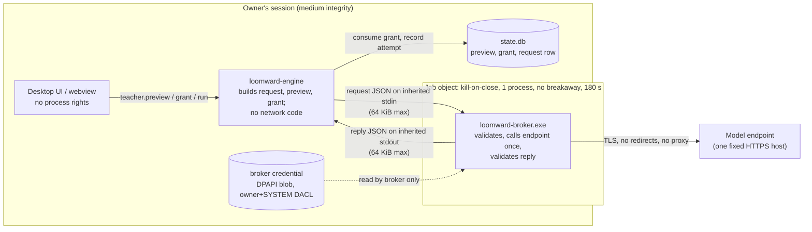

# ADR (proposed): the teacher inference broker

Date: 2026-10-11. Related: LW-111 / [issue 130](https://github.com/Chris0Jeky/Loomward/issues/130),
the L15b measurements in [teacher-sandbox.md](../../research/teacher-sandbox.md), and the earlier
[synthetic broker design](2026-10-10-synthetic-inference-broker-design.md), whose request contract
this ADR keeps and does not repeat. Status: **proposed**, for the driver's review and a security
review. Nothing here is built, and no provider is connected.

## Context

The owner answered agent-hq decision `loomward-teacher-sandbox-path` with (c), "Both" (chat,
2026-10-10 22:46 UTC, agent-hq#356): build the broker (b), and register one AppContainer profile
only to measure, deleting it afterwards. The measurement is done and the profile is deleted.

`HUMAN_TODO.md` q-8 now records the (c) answer and its scope: the one-off measurement is
authorised, existing Codex credentials must never be copied or reused, and a new sign-in or paid
fallback needs separate approval. The agent-hq option's phrase "holds your Codex login" does not
override those limits. This ADR designs a broker that holds **its own** credential, obtained
through a separate, owner-approved sign-in, and never reads Codex's files.

## Decision

1. The teacher is not an agent. Loomward sends one bounded request to a small broker process; the
   broker makes one inference call to one fixed model endpoint and returns one strictly validated
   reply. There is no tool definition, file access, shell or child agent anywhere in the path.
2. The broker is a separate executable, spawned per request by the engine. It is the only Loomward
   component that holds a provider credential or links an HTTP client.
3. Data flows in stages: fixture IDs, then registered synthetic lab metadata, then redacted real
   metadata. Each stage has its own gate; the last needs proven redaction, the owner's q-5 answer
   and a tier re-review.
4. Egress is restricted to the model endpoint in code. That is stated as an application control,
   never as OS enforcement. OS-enforced endpoint-only egress still needs the owner's q-6 rule.
5. No AppContainer profile is used by the broker. Running the broker inside one is an optional later
   hardening that needs its own owner decision (see "What the measurements change").

## Trust boundary

Boundaries, from least to most trusted: the model and its output (untrusted); the network; the
broker (trusted code, holds the secret, sees only the bounded request); the engine (sees real
metadata, holds no secret, has no network); the owner's dialog and grant (the only authorisation).

## The credential

- **What:** whatever the provider qualification gate accepts (existing spec, "Provider
  qualification gate"). Candidates are an API key for a project the owner creates (a paid route,
  so its own approval) or a supported ChatGPT sign-in route, if one exists for inference-only use.
  Subscription CLI access is not API entitlement. If no supported route is available, the broker
  reports `unavailable`; it never falls back to another route or to the Codex CLI.
- **How it arrives:** an explicit owner-run `loomward-broker.exe --sign-in` (or key entry) that the
  owner starts. Agents never enter, copy or read it. Nothing is read from `~/.codex` or any other
  application's store.
- **Where:** `%LOCALAPPDATA%\Loomward\v3\broker\credential.bin`, outside every dataset directory.
- **Protection:** encrypted with DPAPI (`CryptProtectData`, current-user scope, a fixed
  application entropy value). The directory and file get a protected DACL granting only the owner
  SID and SYSTEM (`D:P(A;OICI;FA;;;<owner>)(A;OICI;FA;;;SY)`), with no `ALL APPLICATION PACKAGES`
  ACE. The L15b run measured that an AppContainer cannot read, list or write a directory with this
  DACL shape.
- **Use:** only the broker process decrypts it, only after the request has validated, and only
  for the one outbound call. It never appears in argv, environment, logs, receipts, error text or
  the reply. Revocation is deleting the file plus revoking the key or session at the provider.
- **Limits stated honestly:** any process running as the owner can call DPAPI and the DACL admits
  the owner, so this protects against other users, AppContainer processes and accidental
  publication, not against malware already running as the owner.

## Request contract and data stages

The closed schema, byte, depth and item bounds, digest binding, reply identity rules and the
`source=teacher, weight=0.2, requires_review=true, autonomy_allowed=false` labelling are as in the
[synthetic broker design](2026-10-10-synthetic-inference-broker-design.md). Additionally:

- The request carries no endpoint, credential, header, tool, file ID, conversation ID, callback or
  free-form instruction. Instructions and output schema are compiled into the broker and covered
  by the payload digest.
- The broker re-validates everything the engine validated. It does not trust its caller beyond the
  schema.
- The maximum accepted data stage is compiled into the teacher broker and covered by the runner
  profile digest. A request above that ceiling is `invalid_request` before credential access or
  dispatch. Neither a caller-supplied stage nor a profile field can raise the compiled ceiling.
- **Stage 0, fixture IDs:** the request names committed fixture IDs; the broker resolves them from
  a compiled-in registry. Offline mock provider first, then the qualified provider.
- **Stage 1, registered synthetic lab metadata:** items come from a registered lab root whose
  provenance the engine verifies (never a self-declared `synthetic: true`). Each item also carries
  the registered lab manifest digest and its manifest-local identity. The broker independently
  verifies the digest against its trusted synthetic registry and binds the emitted metadata to
  that manifest entry; copying a known digest onto arbitrary names is not provenance. Missing,
  unknown or mismatched provenance is `invalid_request` before dispatch. The first build accepts
  stage 0 only; stage 1 remains closed until these broker-side checks and negative tests exist.
- **Stage 2, redacted real metadata.** Not authorised. Before any real name or path may flow, all of
  the following must hold, with evidence:
  1. Redaction is a pure, tested function in `loomward-learn`: request-local handles, size buckets,
     the docs/41 section 9.2 sensitive-name rule applied to the name and every ancestor used in
     `context`, and exclusion under sensitive or protected ancestors.
  2. Property tests over generated trees show no emitted field contains a raw path, drive letter,
     user name, or any component from a sensitive-name corpus, and that the output is within bounds.
  3. A hostile-name corpus (injection text, tool-call shapes, very long or odd Unicode names) is
     screened or neutralised before it reaches a request.
  4. The native dialog renders every item exactly as it will be sent, from the stored preview.
  5. The owner has answered q-5 (whether real names may leave the machine, and in what scope) and
     the tier has been re-reviewed (`sensitive_data`, likely T2).
  6. docs/41 section 9.2 and semantics section 11 are amended by the driver to say which
     requirements the broker path replaces, since they were written for a confined Codex runner.

## Egress to the model endpoint only

Without a firewall rule the restriction lives in the broker's code:

- The endpoint (scheme `https`, host, port, path) is a compile-time constant covered by the
  runner profile digest. Nothing in a request or reply can change it.
- One DNS lookup of that host; TLS with system roots and hostname verification; no redirects; proxy
  environment variables ignored; one request per process; reply capped at 64 KiB before parsing;
  180 s deadline from the engine's job.
- The broker links no other network code, and a test asserts the offline stage opens no socket.

This bounds what correct broker code does. It does not bound a compromised broker: the L15b run
measured that even an AppContainer with `internetClient` reaches any public address. OS-enforced
endpoint-only egress needs the q-6 outbound rule scoped to the broker executable, prepared by an
agent and run by the owner. Until then, reports say "endpoint fixed in code, not OS-enforced".

## No file or shell access for the teacher

There is no teacher process with tools: the model receives text and returns JSON. The broker never
executes, evaluates or follows anything in a reply; a tool-shaped or extra-field reply is rejected.
The broker crate denies `std::process`, directory walking and file opens outside its credential
module (a `clippy.toml` `disallowed-methods` list plus a review check). The engine runs it with
exactly three inherited stdio handles, an explicit minimal environment, an empty working directory,
and a job with kill-on-close, an active-process limit of 1 and no breakaway.

## Failure modes

| Failure | Behaviour |
|---|---|
| No credential, or provider route not qualified | `unavailable`; nothing sent; no fallback |
| Request fails validation in the broker | `invalid_request`; nothing sent |
| Credential decrypt fails | `credential_unavailable`; nothing sent; the error has no secret material |
| DNS, TLS or connect failure | `provider_unreachable`; attempt recorded as not dispatched only if no bytes were written |
| Timeout or broker crash after dispatch | `interrupted`; grant stays consumed; never retried (semantics section 11) |
| Reply too large, malformed, wrong items, unknown labels, tool-shaped | `invalid_reply`; nothing stored as a label |
| Provider refusal or abstention | stored as abstention, not as a label |
| Broker binary hash or profile mismatch | `runner_profile_mismatch` before spawn |
| Engine crash mid-request | job kill-on-close ends the broker; request row stays `interrupted` |
| Credential leaked into a log or receipt | prevented by test: canary secret value scanned for in all outputs |

## What the AppContainer measurements change

- **Loopback is closed to AppContainers** (both capability sets timed out). If the broker or its
  caller is ever contained, the channel must be inherited pipes, which the run showed work through
  the boundary. The design already uses stdio, so no listener exists to attack.
- **`internetClient` is all-destinations** (non-provider control reached). An AppContainer adds
  nothing to C-NET; endpoint-only egress remains q-6 either way.
- **Standard AppContainer denied the synthetic directory with no container or ALL APPLICATION
  PACKAGES ACE; `%SystemRoot%` remained accessible.** This does not establish denial of all
  user-owned files: access depends on their ACLs. LPAC would need separate measurement for a
  strict allowlist. A contained broker needs a persistent profile, `LOCALAPPDATA` in
  the environment and a granted credential directory, so it is a separate owner decision, not part
  of this design.
- **A shell starts inside a container and inherits its denials.** OS isolation limits tool effects;
  it does not remove tools. That supports removing the agent (this design) over containing it.
- **Job controls work inside a container**: breakaway denied, kill-on-close, UI limits. The
  broker's job uses the same settings.
- **Codex inside a container was never run** (pin mismatch, no credential). Nothing here depends on
  Codex.

## Test plan and security review

Before the broker is used on anything but synthetic data:

1. Contract tests (offline): closed schema, byte, depth and count bounds checked before parsing;
   digest binding; reply identity; tool-shaped and oversized replies rejected; fixture provenance.
   Include a stage above the compiled ceiling, an unknown lab digest, and real-looking metadata
   carrying a valid digest for a different synthetic manifest entry; all must fail before dispatch.
2. Process tests: spawned with three handles, minimal environment, job limits; a lingering child
   attempt fails; kill-on-close observed.
3. Egress tests: offline stage opens no socket; connected stage refuses redirects, proxy variables
   and any host other than the constant; reply cap enforced against a local stub served over an
   inherited handle, not loopback TCP.
4. Secret tests: a canary credential is never found in stdout, stderr, logs, receipts or panics;
   the DACL on the credential file is read back and asserted.
5. Provider qualification (synthetic): one fixture request, strict valid reply, negative cases.
6. Redaction evidence (stage 2 only): the property and corpus tests above.
7. Security review: one fresh-context adversarial review of the broker crate and its engine seam
   (law 2), plus a second distinct lens (`deep-reviewer` or the cross-vendor lens) because this is a
   credential and data-egress boundary. Findings at CRITICAL or HIGH block use.

Offline or mock passes are never reported as provider qualification, OS confinement or approval
for personal data.

## Consequences

Good: no agent with tools in the data path; the secret and the network live in one small, testable
process; no Windows registration or firewall change. Bad: one more executable and a sign-in flow;
egress is code-enforced until q-6; an owner-level compromise can still reach the credential.
Neutral: the native Codex runner profile in docs/41 section 9.2 becomes unused for the teacher.

## Next slices

1. Broker contract crate and offline mock provider, stage 0 (existing spec's first slice).
2. Broker executable with stdio framing, job spawn from the engine behind the existing preview,
   grant and request transaction; still the mock provider.
3. Credential store (DPAPI plus DACL) and the owner-run sign-in, behind an owner decision on the
   provider route and its cost. Agents build it; the owner runs it.
4. Connected adapter for the qualified endpoint, synthetic fixtures only, with the egress tests.
5. Security review (two lenses) of slices 1 to 4.
6. Redaction module and its evidence; then the owner's q-5 answer and the tier re-review before
   stage 2. Optionally, q-6 preparation and a separate decision on containing the broker.

## Open questions

- For the owner: which provider route may the broker use (API key with its billing, or a supported
  sign-in route if one exists)? This is the decision that "holds your Codex login" left open.
- For the driver: decide whether this ADR becomes ADR-V3-23 in docs/42 and how docs/41 section 9.2
  records the broker path. q-8's decision record is already reconciled; provider qualification and
  implementation of the compiled stage ceiling and broker-side provenance checks remain open.
